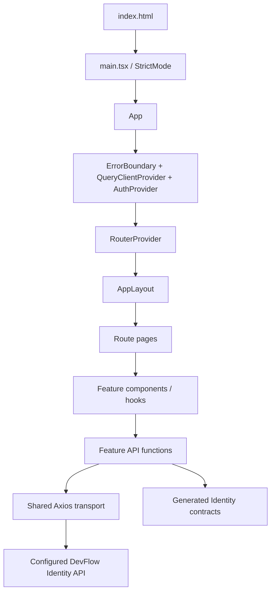
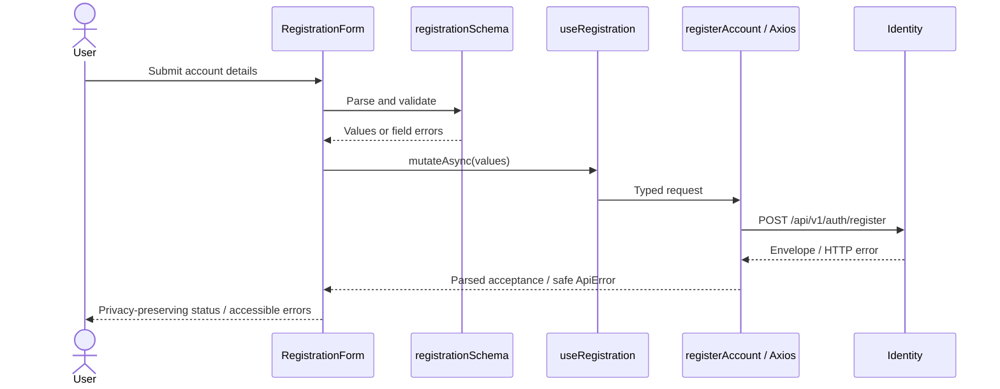

# Architecture: feature-based, browser-native

The frontend is one Vite SPA. Features own user workflows, not replicas of Domain,
Application, Infrastructure and Repository layers. React composition and hooks
already provide boundaries; forwarding every API call through a service and
repository would add names without behavior. The backend still owns business
invariants, storage, authorization and transactions.

## Repository map

```text
src/
  app/                  App composition, providers, shared styles
  api/generated/identity/   Generated Swagger contracts; never hand edit
  components/
    ui/                 Owned Nova/shadcn components, primarily Base UI
    common/             Heading, boundary, loading/error/empty/pending states
    layout/             Brand, header, sidebar, page search and user menu
  config/               Validated public build config and capability inventory
  hooks/                Shared hooks, including mobile viewport detection
  features/
    auth/
      api/              Verified registration request/response boundary
      components/       Registration form
      hooks/            Registration mutation
      pages/            Registration and honest sign-in availability
      schemas/          Form validation matched to backend rules
      types/            Readable aliases to generated types
    organizations/pages/  Contract-blocked organization page
    teams/pages/          Contract-blocked team page
  lib/
    auth/               In-memory session lifecycle, adapter seam, scope checks
    errors/             Safe error normalization
    http/               Axios configuration, guarded refresh and parsing
    query/              Query defaults, tenant keys and switching utility
    utils/              Class-name composition
  routes/               Route definitions, guards, navigation and foundation pages
  stores/               Zustand sidebar preference only
  test/                 MSW server, setup and rendering helper
tests/                  Playwright desktop/mobile flows and axe checks
public/                 Static assets, including favicon.svg
contracts/identity/     Reviewed live OpenAPI snapshot
scripts/                Contract pull/generate/drift verification
deploy/                 Nginx runtime template
docs/                   Beginner-to-maintainer learning materials
plans/                  Implementation checklist and final verification evidence
```

Folders are created when used. Organizations/Teams do not have fake APIs, schemas
or generated contracts just to satisfy a directory diagram. Their complete
vertical slices depend on backend implementation; see the gap register.

## Design ownership

[DESIGN.md](../DESIGN.md) defines the design contract. `components.json` selects
Nova (`base-nova`), the neutral theme, and Lucide; `src/app/styles/globals.css`
implements semantic colors, radius mappings, and the locally bundled Geist font.
Tailwind v4 uses the Vite plugin and CSS `@theme inline` aliases, with no separate
Tailwind config. Typography and spacing reuse the imported Tailwind scale.

Reuse the owned components and their variants. Most interaction primitives under
`components/ui` use Base UI; the older shell directly uses Radix for its mobile
navigation and menus. Their composition APIs differ: Base UI uses `render`, Radix
uses `asChild`. Keep each primitive's root and children together. See the
[styling guide](styling-guide.md) for examples and the current theme-coverage gaps.
Token/default changes must update DESIGN.md and implementation together; run
`npm run design:lint` and compare values with CSS and component source.

## Startup and dependency direction



Shared `lib` and UI code do not import feature internals. Feature types may alias
generated contracts. Layout composes navigation and shared session state. The
router imports feature pages lazily so registration's form library loads when
needed. Session infrastructure knows an adapter interface, not undocumented URLs.

`@/` is configured in both tsconfig and Vite. Type-only imports prevent generated
schemas from becoming unnecessary runtime dependencies. Avoid barrel files that
accidentally import a whole feature or create a cycle; import the owning file.

## Data flow: registration



The form owns field values. Query owns mutation state. API functions own transport
and parsing. Server field errors return to the form; unmatched backend validation
errors appear in the form summary. Successful registration resets form/mutation
state to avoid retaining a password longer than necessary.

## Routes and composition

Public foundation pages live inside AppLayout: overview, organization/team
availability, identity, settings and learning. Registration and sign-in availability
are standalone pages. Scoped URL skeletons use
`/organizations/:organizationId/teams/:teamId`, behind ProtectedRoute. Today they
cannot expose tenant data because the production session adapter is absent. When
connected, they must additionally load membership and effective permissions before
mounting private views. PermissionRoute is an exact-scope guard ready for that work.

Fallbacks exist at three boundaries: Suspense for page modules, route errorElement
for routing/lazy-load failures, and ErrorBoundary for application rendering errors.
HTTP errors are handled by each workflow; they do not belong in a render boundary.

## Extension rule

Put business behavior in a feature, reusable interaction in a component/hook, and
cross-cutting transport/lifecycle behavior in lib. Introduce abstractions only when
they centralize a real invariant. See [decisions](architecture-decisions.md) and
the step-by-step [feature guide](feature-development-guide.md).
