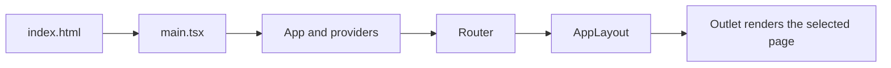
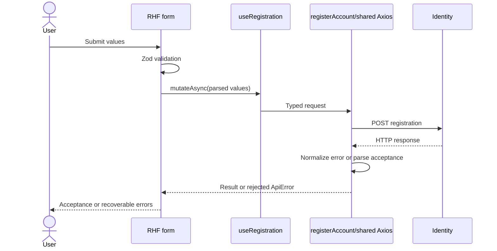

# Build a DevFlow feature by hand: a course for a .NET developer

This course assumes you can write C# but have never built a frontend. You will
learn enough JavaScript, TypeScript, CSS, and React to build a feature yourself,
understand its behavior, and diagnose mistakes. You do not need to memorize the
whole stack before starting. Read an explanation, type the example, check the
result, and then move on.

Our first feature is **Practice tasks**: an educational task list stored only in
browser memory. It is not DevFlow's planned Tasks module. It makes no HTTP requests,
has no tenant data, and resets when you reload or leave its page. We will then
trace **real registration**, the existing frontend integration, to learn where
server state and backend contracts enter the picture.

The practice code below is for your learning branch. This document does not add
practice screens or endpoints to the production application. The examples use
the repository's current installed dependencies; do not initialize another React
app, install a second component library, or reapply a shadcn preset.

## How to use this course

Work in order the first time. A **checkpoint** is a version that should compile
and behave as described before you continue. A **full-file replacement** means
replace the entire contents of the named file, including imports. An **insertion**
means add only the displayed lines at the stated location. A **reading excerpt**
is existing code to understand, not code to paste into a new production file.
Console exercises run in browser DevTools, not in a `.tsx` file.

Code fences marked `tsx`, `ts`, or `javascript` indicate the language, not a shell
command. Fences marked `powershell` run in your terminal. Never paste the terminal
prompt itself. Keep one terminal for Vite and open a second for checks.

Each practical lesson includes a goal, concepts, exact action, explanation and
data flow, checkpoint, troubleshooting, and exercise with its answer. Take the
stopping points seriously: debugging ten accumulated mistakes is much harder
than debugging the last small edit.

### Contents

- [Part 1 — Run and understand the application](#part-1--run-and-understand-the-application)
  - [1. Start from a safe working directory](#1-start-from-a-safe-working-directory)
  - [2. Trace startup and change one sentence](#2-trace-startup-and-change-one-sentence)
- [Part 2 — Learn the language you will actually use](#part-2--learn-the-language-you-will-actually-use)
  - [3. Values, functions, and callbacks](#3-values-functions-and-callbacks)
  - [4. Collections and immutable updates](#4-collections-and-immutable-updates)
  - [5. TypeScript, modules, and JSX](#5-typescript-modules-and-jsx)
- [Part 3 — Build and style a page](#part-3--build-and-style-a-page)
  - [6. Create the page and register its route](#6-create-the-page-and-register-its-route)
  - [7. Understand layout, tokens, and accessibility](#7-understand-layout-tokens-and-accessibility)
- [Part 4 — Make the local feature interactive](#part-4--make-the-local-feature-interactive)
  - [8. Render typed practice data](#8-render-typed-practice-data)
  - [9. Extract a component with props](#9-extract-a-component-with-props)
  - [10. Add a controlled form and state](#10-add-a-controlled-form-and-state)
  - [11. Replace manual validation with RHF and Zod](#11-replace-manual-validation-with-rhf-and-zod)
  - [12. Complete, edit, and remove tasks](#12-complete-edit-and-remove-tasks)
  - [13. Add search and status filters](#13-add-search-and-status-filters)
  - [14. Put filters in the URL](#14-put-filters-in-the-url)
- [Part 5 — Understand real backend integration](#part-5--understand-real-backend-integration)
  - [15. Read the actual contract and types](#15-read-the-actual-contract-and-types)
  - [16. Trace transport and runtime validation](#16-trace-transport-and-runtime-validation)
  - [17. Follow a mutation back to the form](#17-follow-a-mutation-back-to-the-form)
  - [18. Plan a future server-backed list](#18-plan-a-future-server-backed-list)
- [Part 6 — Test, debug, and work independently](#part-6--test-debug-and-work-independently)
  - [19. Write a validation test](#19-write-a-validation-test)
  - [20. Test the local feature as a user](#20-test-the-local-feature-as-a-user)
  - [21. Read a real MSW test](#21-read-a-real-msw-test)
  - [22. Check the browser and production build](#22-check-the-browser-and-production-build)
  - [23. Debug by following the failing boundary](#23-debug-by-following-the-failing-boundary)
  - [24. Use the next-feature worksheet](#24-use-the-next-feature-worksheet)
- [Checkpoint map and final file tree](#checkpoint-map-and-final-file-tree)
- [Glossary and further reading](#glossary-and-further-reading)
- [Verification of this tutorial](#verification-of-this-tutorial)

## Part 1 — Run and understand the application

### 1. Start from a safe working directory

**Goal.** Run the existing app without replacing its setup or losing your work.

**Concepts first.** There are three places code runs:

| Place              | Runs here                                          | .NET comparison and limit                                      |
| ------------------ | -------------------------------------------------- | -------------------------------------------------------------- |
| Your machine       | Node runs npm, Vite, TypeScript, and tests         | Like SDK/build tooling; Node is not the production API         |
| The user's browser | JavaScript renders UI and sends HTTP requests      | A program delivered to each user, not a server-side Razor view |
| Backend server     | ASP.NET handles authorization, validation, storage | The authoritative owner of business data and permissions       |

HTML describes document structure. CSS controls appearance. JavaScript supplies
browser behavior. TypeScript checks JavaScript source before it runs. React helps
describe and update the UI. Vite serves the app during development and bundles it
for release. npm installs packages and runs named commands.

**Exact action.** Open PowerShell in the existing checkout, then run:

```powershell
Set-Location D:\Projects\Task-Management-FE
Get-Location
git status --short
node --version
npm --version
```

`Set-Location` changes the working directory. `Get-Location` confirms it. Relative
paths and npm scripts are resolved from that directory. `git status` shows existing
changes; do not discard them to make this exercise easier. The selected runtime
is Node 24.21.0 and npm 11.x; see `.nvmrc` and `package.json`.

If your working tree is clean, create a practice branch:

```powershell
git switch -c codex/learn-manual-features
```

If it contains unrelated changes, first preserve them using your normal Git
workflow, or use a separate checkout. A new branch alone does **not** isolate
uncommitted changes. If the branch already exists, use `git switch` with its name
without `-c`; do not delete it to repeat this lesson.

For a first install, run `npm ci`. If dependencies are already installed and the
lockfile has not changed, you can keep that installation. `npm ci` replaces
`node_modules` using the lockfile; it is not required every time you start Vite.

```powershell
npm ci
```

Create your local environment file only if it does not already exist:

```powershell
if (-not (Test-Path .env.development)) {
  Copy-Item .env.development.example .env.development
}
npm run dev
```

**Explanation and data flow.** `package.json` is roughly project metadata plus
named build commands. `package-lock.json` pins resolved dependency versions,
including dependencies of dependencies. `node_modules` contains the installed
packages. Do not edit it to change application behavior. A dependency is available
to import; installing it does not automatically create a screen or integrate an API.

`npm run dev` finds the `dev` script in package.json and starts Vite. Vite keeps
running, so that terminal does not return to a prompt. Open
`http://127.0.0.1:5173` in the browser. Press Ctrl+C in that terminal to stop it.
Use a second terminal, in the same repository directory, for other commands.

The default API base is `/api`; Vite proxies it to the configured Identity host.
The practice task list does not need that backend. `VITE_` environment values are
public, compiled configuration, never a place for passwords or integration keys.
Restart Vite after changing an env file. See [API configuration](api-integration.md)
when you need a real backend connection.

**Checkpoint.** The overview appears. In the second terminal run
`npm run typecheck`; it should exit successfully. A command returning to the prompt
is normal for a check, while Vite staying open is normal for a server.

**Troubleshooting.** “Could not read package.json” usually means the wrong working
directory. If PowerShell blocks `npm.ps1`, use `npm.cmd` with the same arguments.
“Port 5173 is already in use” means another process owns the port; inspect your
existing Vite terminal and stop your own duplicate server. A failed registration
request does not mean the frontend failed to start.

**Exercise.** Find which script builds production output and where it goes.

**Answer.** `build` runs `npm run typecheck && vite build`. `&&` means the second
command runs only if the first succeeds. Output goes to `dist/`; you edit `src/`,
not generated `dist/` assets.

### 2. Trace startup and change one sentence

**Goal.** Find the code responsible for something you can see.

**Concepts first.** The **DOM** is the browser's live tree of document elements.
A **component** is a function describing some UI. A **render** evaluates component
functions; React then reconciles that description with the DOM. It does not
request a new ASP.NET view for every interaction.

**Exact action.** Read these files in this order:

```text
index.html                          HTML and the root element
src/main.tsx                        React root, CSS import, StrictMode
src/app/App.tsx                     Providers and RouterProvider
src/app/providers/providers.tsx     Query, auth, error boundary, Sonner
src/routes/router.tsx               URL-to-page mapping
src/components/layout/app-layout.tsx Navigation shell and Outlet
src/routes/pages/overview-page.tsx   Current home page
```

The important startup relationship is:



In `overview-page.tsx`, find `title="A better flow starts here."`. Change only that
prop to `title="I can edit this page."`, save, and observe the browser. This is a
temporary text exercise; restore the original title afterward by editing that
same line, not by resetting the whole file.

**Explanation and data flow.** The index HTML loads `main.tsx`. `createRoot` attaches
React to the element with `id="root"`. Providers give shared services/context to
their descendants, somewhat like making dependencies available within a scope.
Their lifetime follows the rendered tree, not a single HTTP request.

The router maps `/` to an index page inside AppLayout. Layout's `<Outlet />`
marks where the selected page goes. The page passes text into PageHeading through
**props**, which are explicit inputs similar to constructor arguments.

Vite's Fast Refresh recompiles changed modules. It often preserves local state,
so saving a file is different from a full browser reload. StrictMode adds
development checks and may evaluate rendering/updater logic more than once;
keep rendering pure rather than treating each render as a write opportunity.

**Checkpoint.** Your changed title appears, then the original returns when you
restore it. Run `npm run typecheck` again.

**Troubleshooting.** If you see the Vite error overlay, fix the first syntax/import
error rather than refreshing repeatedly. If another page is open, navigate to `/`.
If your edits do nothing, confirm the terminal and editor use the same checkout.

**Exercise.** Why does changing the title not create a new backend endpoint?

**Answer.** It changes a component input rendered in the browser. HTTP requests
only happen when application code explicitly makes them. A React page and an API
controller are different boundaries.

**Stopping point:** you can run the application, locate its home page, and explain
how a URL reaches a component. Continue only after the app is working again.

## Part 2 — Learn the language you will actually use

### 3. Values, functions, and callbacks

**Goal.** Read the syntax that appears in event handlers without guessing.

**Concepts first.** JavaScript has values and functions. TypeScript adds annotations
to that language. An arrow function is similar to a C# lambda, and a callback is
a function passed to another function to run later or for each item.

**Exact action and code.** Open DevTools → Console. Type these lines yourself.
Do not enter TypeScript annotations into this JavaScript console. If the browser
disallows pasted text, type the short exercise instead of disabling its protection.

```javascript
const title = 'Read a React component';
let completed = false;
completed = true;
const task = { id: 'example-1', title, completed };
const describe = (item) => `${item.title}: ${item.completed ? 'done' : 'open'}`;
console.log(describe(task));
```

**Explanation and data flow.**

- `const` prevents reassigning that variable binding. It does not make an object
  deeply immutable. Prefer it unless the binding itself must change.
- `let` permits reassignment. Strings use quotes; booleans are `true` and `false`.
- `{ id: ..., title, completed }` creates an object. The shorthand `title` means
  `title: title`. This is not a C# anonymous object with runtime type enforcement.
- `(item) => ...` creates a function. Parentheses surround parameters; `=>`
  separates parameters from the body. A short expression body returns implicitly.
- Backticks create a template string. `${...}` inserts the result of an expression.
- `condition ? a : b` is the conditional operator, as in C#.
- `describe(task)` invokes the function now. Passing `describe` supplies the
  function itself. This distinction matters for React `onClick` props.

The code creates data, invokes `describe`, and logs one string. None of these
plain variables cause React to rerender; they are not React state.

**Checkpoint.** The last line logs `Read a React component: done`. Console commands
are independent of your source files. Reloading clears this exercise's bindings.

**Troubleshooting.** “Identifier has already been declared” means you entered the
same top-level `const` again. Reload, or use a new variable name. “Unexpected token
':'” often means TypeScript syntax was pasted into the JavaScript console.

**Exercise.** Rewrite `describe` with a block body.

**Answer.** A block needs an explicit `return`:

```javascript
const describeWithBlock = (item) => {
  return `${item.title}: ${item.completed ? 'done' : 'open'}`;
};
console.log(describeWithBlock(task));
```

### 4. Collections and immutable updates

**Goal.** Understand the add, complete, and remove operations before adding React.

**Concepts first.** `map` resembles LINQ `Select`; `filter` resembles `Where`.
JavaScript's array methods here execute immediately and return arrays, rather than
returning a deferred `IEnumerable<T>`. Immutability means producing a new value
instead of changing one React already holds.

**Exact action and code.** In the Console, run this separate example:

```javascript
const original = [
  { id: 'a', title: 'Learn props', completed: false },
  { id: 'b', title: 'Learn state', completed: false },
];
const added = [...original, { id: 'c', title: 'Practice', completed: false }];
const toggled = added.map((item) =>
  item.id === 'a' ? { ...item, completed: !item.completed } : item,
);
const remaining = toggled.filter((item) => item.id !== 'b');
const { title: firstTitle } = original[0];
console.log(original.length, added.length, remaining.length, firstTitle);
```

**Explanation and data flow.** `...original` spreads existing elements into a new
array. `...item` copies an object's existing properties into a new object. The
later `completed` property overrides the earlier one. These are **shallow** copies;
nested mutable objects would need their own update boundary.

`map` visits each item. The callback returns a changed copy for the matching ID
and the original object for other items. `filter` keeps items whose callback
returns true. `!` negates a boolean; `===` compares without JavaScript's implicit
type conversions. Use stable IDs, not titles, because titles can be duplicated.

Destructuring extracts values: `const { title } = item` reads a property. Writing
`title: firstTitle` renames the local binding. Array destructuring, such as
`const [value, setter] = ...`, extracts by position instead of property name.

**Checkpoint.** The output is `2 3 2 Learn props`. `original` still contains two
incomplete tasks. Later React code will pass the newly created arrays to a setter.

**Troubleshooting.** `map((item) => { ...item })` is not an object-returning arrow
expression: those braces begin a function block. Use `map((item) => ({ ...item }))`
for an immediate object expression, or use a block with `return`.

**Exercise.** Produce an array of open-task titles without changing `original`.

**Answer.** `original.filter((item) => !item.completed).map((item) => item.title)`
first selects records, then projects their titles. Avoid `original.push(...)` or
`item.completed = true` when the array is held in React state.

### 5. TypeScript, modules, and JSX

**Goal.** Recognize the extra syntax in `.ts` and `.tsx` files.

**Concepts first.** `.ts` is TypeScript; `.tsx` also allows JSX markup. A type is a
compile-time description. JSX is an expression describing React elements; it
looks like HTML but accepts component props and JavaScript expressions.

**Exact action.** Read this syntax specimen now; do not add it to the app. You will
create the actual task type in lesson 8 and components in lessons 6 and 9.

```tsx
type ExampleTask = { id: string; title: string; completed: boolean };
type ExampleFilter = 'all' | 'open' | 'completed';
type ExampleProps = { task: ExampleTask; subtitle?: string };

function ExampleLabel({ task, subtitle }: ExampleProps) {
  return (
    <p className="text-sm">
      {task.title} {subtitle ?? 'Practice only'}
    </p>
  );
}

const example: ExampleTask = { id: 'a', title: 'Read JSX', completed: false };
const filter: ExampleFilter = 'all';
const element = <ExampleLabel task={example} subtitle={filter} />;
console.log(element);
```

**Explanation and data flow.**

- `: string` and `: ExampleProps` annotate types. Types disappear from the built
  JavaScript. A JSON response still needs validation at runtime.
- `'all' | 'open' | 'completed'` is a union of permitted string literals, similar
  to a small set of allowed enum values. It does not create runtime validation.
- `subtitle?: string` permits omission. Reading it can produce `undefined`.
  `??` supplies a fallback for null/undefined, without replacing `''` or `0`.
- `<ExampleTask[]>` in `useState<ExampleTask[]>([])` is a **generic type argument**,
  comparable to a C# generic argument. Here it tells React what an empty array will
  contain. `.tsx` parser context distinguishes type arguments from JSX elements.
- `function ExampleLabel` is a component because we use it as a capitalized JSX
  element. Lowercase `<p>` is a native DOM element. `task={example}` passes an
  object expression; `subtitle="all"` would pass a literal string.
- `className` supplies CSS classes. `htmlFor` links a label to an input's `id`.
  JavaScript goes inside `{...}` in JSX. A JSX comment is `{/* comment */}`.
- A component returns one enclosing tree. A fragment `<>...</>` groups siblings
  without adding a DOM element. `children` is the prop containing nested content.

An export publishes a module value; an import makes it available in another file:

```ts
// Reading examples: each line belongs to its owning module, not one file.
// A named export:
export type TaskLabel = { title: string };
// A consuming file would use: import type { TaskLabel } from './task-label';
```

Named imports use braces and the exported name. A default export is imported without
braces; this project uses default exports for lazy route pages. `import type`
imports only a type and adds no runtime module dependency. `@/` means `src/` here,
configured in both Vite and TypeScript. It is not an npm package.

**Checkpoint.** Open `PageHeading` and identify its props type, optional `action`,
and `{title}` expression. No files have to change for this reading lesson.

**Troubleshooting.** “Cannot find name” often means a missing import or misspelling.
“No default export” means the import style and export style disagree. “Possibly
undefined” asks you to handle missing data, not to add `!` everywhere. In this
repository even `array[0]` can be undefined under strict indexed-access checks.

**Exercise.** Why would `JSON.parse(text) as ExampleTask` not prove a valid task?

**Answer.** The assertion changes what TypeScript assumes. It does not inspect
the JSON. A runtime validator such as Zod must establish that external data has
the expected shape. We will use Zod in lesson 11.

**Stopping point:** you can explain an object spread, array callback, type annotation,
component prop, and import. Keep these lessons open as a syntax reference.

## Part 3 — Build and style a page

### 6. Create the page and register its route

**Goal.** Add a real page to your practice branch before adding interactive state.

**Concepts first.** A route maps a URL path to an element. A page composes other
components for that route. A reusable component is unaware of which URL mounted
it. React Router's `Link` navigates without reloading the whole app.

**Exact action.** In the editor create
`src/features/learning-tasks/pages/learning-tasks-page.tsx`. Create missing folders
with the editor's New Folder command. Full-file replacement, checkpoint **page**:

<!-- tutorial-file: page | src/features/learning-tasks/pages/learning-tasks-page.tsx -->

```tsx
import { Link } from 'react-router-dom';
import { PageHeading } from '@/components/common/page-heading';
import { Button } from '@/components/ui/button';
import { Card, CardContent, CardHeader, CardTitle } from '@/components/ui/card';

export default function LearningTasksPage() {
  return (
    <>
      <PageHeading
        eyebrow="LEARNING EXERCISE"
        title="Practice tasks"
        description="Local practice only. Changes reset when this page unmounts or reloads."
      />
      <Card>
        <CardHeader>
          <CardTitle>My first feature</CardTitle>
        </CardHeader>
        <CardContent className="flex flex-col gap-4">
          <p>No task API is connected to this exercise.</p>
          <Button
            variant="outline"
            nativeButton={false}
            render={<Link to="/guide" />}
          >
            Open the existing guide
          </Button>
        </CardContent>
      </Card>
    </>
  );
}
```

In `src/routes/router.tsx`, insert this declaration immediately **before**
`const Layout = lazy(...)`. It uses the existing `lazy` import; do not import it twice.

<!-- tutorial-edit: page | src/routes/router.tsx | before | const Layout = lazy -->

```tsx
const LearningTasks = lazy(
  () => import('@/features/learning-tasks/pages/learning-tasks-page'),
);
```

In that same file insert this route immediately **after** the existing
`{ path: '/guide', element: <Guide /> },` entry inside Layout's children:

<!-- tutorial-edit: page | src/routes/router.tsx | after | { path: '/guide', element: <Guide /> }, -->

```tsx
{ path: '/learn/tasks', element: <LearningTasks /> },
```

In `src/routes/navigation.ts`, insert this object immediately **before** the
closing `];` of `navigation`. It reuses the existing BookOpen import:

<!-- tutorial-edit: page | src/routes/navigation.ts | before | ]; -->

```tsx
  {
    to: '/learn/tasks',
    label: 'Practice tasks',
    icon: BookOpen,
    description: 'Learning exercise; local memory only',
  },
```

**Explanation and data flow.** The default export lets `lazy` import the page.
`lazy(() => import(...))` defers loading its module until needed. The existing
Suspense boundary provides the loading fallback for the page module. This does
not mean our local tasks have a server-loading state.

The route goes inside the existing layout children, so you get its sidebar,
header, main landmark, and providers. Do not create a second React root, router,
QueryClient, or `<main>` inside this page. The navigation object gives the shell
a label, page-search entry, and document title. Because the current shell splits
navigation into groups, the appended practice link appears in its lower group.

Card's title export is a styled `div`, not automatically an `h2`. On this small
page the PageHeading supplies the actual `h1`. Later the task region will get an
explicit accessible heading. Visual styling and HTML semantics are separate.

`Button` uses Base UI, so `render` composes it with a Link. The final element is
an anchor: `nativeButton={false}` tells the primitive not to assume a native
button. Do not nest a button inside a link or pass Radix's `asChild` here.

**Checkpoint.** Run `npm run typecheck`, then open `/learn/tasks`. You should see
Practice tasks inside the existing shell. The guide link should navigate to
`/guide`; Back returns to the practice page. The practice navigation entry should
also appear in page search. No task network request should occur.

**Troubleshooting.** A not-found view means the route entry is missing or misplaced.
A page without the shell usually means it was registered outside Layout's children.
An import error means the file path or default export does not match. Fix these
before adding another file.

**Exercise.** Change only the card sentence to explain that refreshing resets data.

**Answer.** Replace the `<p>` text, for example with
`Refreshing this exercise starts a new in-memory session.` Text is a prop/child
change, so it does not require another route or a global CSS edit.

### 7. Understand layout, tokens, and accessibility

**Goal.** Read the page's appearance and make a controlled layout experiment.

**Concepts first.** Every element has content, padding inside its boundary, a border,
and margins outside it. `gap` separates children of flex/grid containers. Flexbox
organizes a row or column; grid organizes columns and rows. Tailwind utilities
are small classes that set these CSS properties.

**Exact action.** Inspect CardContent in DevTools and find its
`flex flex-col gap-4` classes. In the editor temporarily change `gap-4` to `gap-6`,
observe the larger separation, then return it to `gap-4`. This is a layout edit;
keep the Card's existing colors, type, radius, and variants.

**Explanation and data flow.** These are the utilities you will use next:

| Utility                     | Meaning                                                          | Why it matters                                          |
| --------------------------- | ---------------------------------------------------------------- | ------------------------------------------------------- |
| `flex flex-col`             | Flex container with vertical children                            | Predictable stacks without adding margins to each child |
| `gap-4`                     | 1rem separation with the current 0.25rem spacing step            | Reuses the documented rhythm                            |
| `grid gap-4 sm:grid-cols-2` | One column, then two from `sm`                                   | Mobile-first layout that adapts to width                |
| `min-w-0`                   | Allows a flex/grid child to shrink below intrinsic content width | Long titles must not push the page sideways             |
| `break-words`               | Allows wrapping an otherwise unbroken long word                  | Keeps identifiers within a narrow task row              |
| `bg-background`             | Uses the semantic background role                                | Reads theme values rather than fixing a palette color   |
| `text-muted-foreground`     | Supporting text role                                             | Quiet hierarchy; still check actual contrast            |
| `sr-only`                   | Visually hidden but available to assistive technology            | Useful for a real heading that need not be prominent    |

At the normal 16px root, 1rem is 16px. Rem units also respond to the root font size.
An unprefixed class applies everywhere; `sm:` applies from 40rem and up, `md:`
from 48rem, `lg:` from 64rem. `@md` container queries in some generated components
are different: they respond to container width, not the viewport.

[DESIGN.md](../DESIGN.md) is the design contract. `components.json` selects Nova
(`base-nova`), neutral colors, and Lucide. `globals.css` imports Tailwind v4 and
locally bundled Geist Variable. Its `@theme inline` maps semantic roles to CSS
variables, whose `.dark` overrides provide dark values. Do not add another
Tailwind config, font stack, palette, or UI library. Existing fixed-light shell
styles are documented gaps; the presence of dark tokens is not complete dark UI.

Use links for navigation, buttons for actions, visible labels for inputs, and
`type="button"` on non-submit form buttons. An icon-only button needs an accessible
name; our task actions will have visible words. Compact controls still need enough
touch space. Tab order follows the document; do not rearrange it with positive
`tabIndex` values to compensate for a poor layout.

**Checkpoint.** Inspect the page at 375px and 1440px width. Tab to the guide link;
its focus must be visible. Check that your original spacing has been restored.
`npm run design:lint` should pass, but it validates the document rather than this
rendered screen.

**Troubleshooting.** A utility that does nothing may be incomplete, misspelled,
overridden, or applied to the wrong layout parent. Keep class strings literal;
do not build `bg-${color}-500`. Use DevTools Computed to find the winning value.

**Exercise.** Why should a long title wrap instead of always using `truncate`?

**Answer.** Truncation can hide the information needed to distinguish tasks.
Wrapping preserves it here. In a dense production table, truncation requires an
accessible way to obtain the full value; a hover-only tooltip is insufficient.

**Stopping point:** your practice branch has a routed page and no additional
dependencies. The next part changes that page into an interactive feature.

## Part 4 — Make the local feature interactive

### 8. Render typed practice data

**Goal.** Turn records into visible list items before introducing mutation.

**Concepts first.** A frontend model describes what the view needs. This one is
educational and local, so it is handwritten. A future server DTO must instead come
from the verified generated contract. An array needs stable React **keys** so React
can match a row across renders, especially when items are inserted or removed.

**Exact action.** Create `src/features/learning-tasks/types/learning-task.ts`:

<!-- tutorial-file: records | src/features/learning-tasks/types/learning-task.ts -->

```ts
export type LearningTask = {
  id: string;
  title: string;
  completed: boolean;
};
```

Replace the **whole** practice page with this version, checkpoint **records**:

<!-- tutorial-file: records | src/features/learning-tasks/pages/learning-tasks-page.tsx -->

```tsx
import { PageHeading } from '@/components/common/page-heading';
import { Badge } from '@/components/ui/badge';
import type { LearningTask } from '@/features/learning-tasks/types/learning-task';

const practiceTasks: LearningTask[] = [
  { id: 'read', title: 'Read a component', completed: false },
  { id: 'run', title: 'Run the app', completed: true },
];

export default function LearningTasksPage() {
  return (
    <>
      <PageHeading
        eyebrow="LEARNING EXERCISE"
        title="Practice tasks"
        description="Local practice only. Changes reset when this page unmounts or reloads."
      />
      <ul aria-label="Practice tasks" className="flex flex-col gap-3">
        {practiceTasks.map((task) => (
          <li
            key={task.id}
            className="flex min-w-0 flex-wrap items-center gap-3 rounded-lg border p-4"
          >
            <span className="min-w-0 flex-1 break-words">{task.title}</span>
            <Badge variant="secondary">
              {task.completed ? 'Completed' : 'Open'}
            </Badge>
          </li>
        ))}
      </ul>
    </>
  );
}
```

The old Card and guide-link imports disappear because that earlier page content
was replaced. Do not keep unused imports: strict TypeScript reports them.

**Explanation and data flow.** `LearningTask[]` means an array of LearningTask
objects. The array exists outside the component because it is currently a fixed
example. `map` returns one `<li>` element per task. JSX's braces evaluate that
array of elements. `key={task.id}` helps React track each row; key is not passed as
a normal prop and does not create an HTML ID.

Badge is the existing component, not a hand-styled status span. It shows words
as well as appearance, so meaning does not depend on color. The wrapping classes
are layout choices; they do not replace Nova's semantic theme.

**Checkpoint.** `npm run typecheck` passes and `/learn/tasks` shows two rows, one
Open and one Completed. There are still no task HTTP requests.

**Troubleshooting.** “Each child in a list should have a unique key” means the key
is missing or duplicated. Put it on the outer element returned by `map`, not on
an inner span. Do not use title or array index as a substitute for real identity.

**Exercise.** Add a third local example with a unique ID and a long title. Observe
wrapping, then remove that extra example so later checkpoints start consistently.

**Answer.** Add an object with the same three properties to `practiceTasks`.
Use an ID such as `'inspect'`; keep `completed` a boolean, not the string `'false'`.

### 9. Extract a component with props

**Goal.** Separate list rendering from page composition without creating a service
or repository layer.

**Concepts first.** Props flow down from an owner into a child. A child should not
reach into another feature's private state. `readonly LearningTask[]` tells
TypeScript this component will read the array rather than push or splice items.
It is compile-time assistance, not runtime freezing.

**Exact action.** Create
`src/features/learning-tasks/components/task-list.tsx`, checkpoint **components**:

<!-- tutorial-file: components | src/features/learning-tasks/components/task-list.tsx -->

```tsx
import { Badge } from '@/components/ui/badge';
import type { LearningTask } from '@/features/learning-tasks/types/learning-task';

type TaskListProps = { tasks: readonly LearningTask[] };

export function TaskList({ tasks }: TaskListProps) {
  return (
    <ul aria-label="Practice tasks" className="flex flex-col gap-3">
      {tasks.map((task) => (
        <li
          key={task.id}
          className="flex min-w-0 flex-wrap items-center gap-3 rounded-lg border p-4"
        >
          <span className="min-w-0 flex-1 break-words">{task.title}</span>
          <Badge variant="secondary">
            {task.completed ? 'Completed' : 'Open'}
          </Badge>
        </li>
      ))}
    </ul>
  );
}
```

Replace the full page with this shorter version:

<!-- tutorial-file: components | src/features/learning-tasks/pages/learning-tasks-page.tsx -->

```tsx
import { PageHeading } from '@/components/common/page-heading';
import { TaskList } from '@/features/learning-tasks/components/task-list';
import type { LearningTask } from '@/features/learning-tasks/types/learning-task';

const practiceTasks: LearningTask[] = [
  { id: 'read', title: 'Read a component', completed: false },
  { id: 'run', title: 'Run the app', completed: true },
];

export default function LearningTasksPage() {
  return (
    <>
      <PageHeading
        eyebrow="LEARNING EXERCISE"
        title="Practice tasks"
        description="Local practice only. Changes reset when this page unmounts or reloads."
      />
      <TaskList tasks={practiceTasks} />
    </>
  );
}
```

**Explanation and data flow.** The page supplies `tasks`, and TaskList reads it.
`{ tasks }: TaskListProps` destructures the incoming props object and checks its
shape. The exported function is defined at module scope. Defining TaskList inside
the page would create a new component type each time the page renders and can
cause remounts and lost input state.

This is composition: a page combines a heading and a list. We extracted a visual
responsibility, not a forwarding abstraction for its own sake.

**Checkpoint.** Typecheck passes and the page looks the same. A refactor should
preserve observable behavior. Inspect TaskList in your editor and confirm it does
not import the page or router.

**Troubleshooting.** `TaskList` uses a named export, so import it with braces.
The page still uses a default export because the lazy route expects one. If the
list disappears, check that `tasks={practiceTasks}` was passed.

**Exercise.** Which component should eventually own mutable task state?

**Answer.** The page, the nearest common owner of the form and list. Both need
the same collection. Lifting state there is enough; a global store adds no value.

### 10. Add a controlled form and state

**Goal.** Type a title and add an item by learning the browser event/state loop.

**Concepts first.** `useState` is a React hook: call it unconditionally at component
top level. It returns a current value and a setter. Calling the setter schedules
a render. An ordinary local variable would be recreated on the next function call
and would not tell React to update the screen.

A **controlled input** receives its displayed value from React state. Its change
handler stores what the user typed. `preventDefault` stops the browser's default
form navigation so React can handle submission in the existing page.

**Exact action.** Create
`src/features/learning-tasks/components/task-form.tsx`, checkpoint **controlled**:

<!-- tutorial-file: controlled | src/features/learning-tasks/components/task-form.tsx -->

```tsx
import { useId, useState, type FormEvent } from 'react';
import { Button } from '@/components/ui/button';
import {
  Field,
  FieldError,
  FieldGroup,
  FieldLabel,
} from '@/components/ui/field';
import { Input } from '@/components/ui/input';

type TaskFormProps = { onSave: (title: string) => void };

export function TaskForm({ onSave }: TaskFormProps) {
  const inputId = useId();
  const [title, setTitle] = useState('');
  const [error, setError] = useState('');

  function submit(event: FormEvent<HTMLFormElement>) {
    event.preventDefault();
    const cleaned = title.trim();
    if (!cleaned) {
      setError('Enter a task title.');
      return;
    }
    onSave(cleaned);
    setTitle('');
    setError('');
  }

  return (
    <form
      onSubmit={submit}
      noValidate
      className="flex flex-col gap-4"
      aria-label="Task editor"
    >
      <FieldGroup>
        <Field data-invalid={Boolean(error)}>
          <FieldLabel htmlFor={inputId}>Task title</FieldLabel>
          <Input
            id={inputId}
            value={title}
            onChange={(event) => setTitle(event.target.value)}
            aria-invalid={Boolean(error)}
            aria-describedby={error ? `${inputId}-error` : undefined}
          />
          {error && <FieldError id={`${inputId}-error`}>{error}</FieldError>}
        </Field>
      </FieldGroup>
      <Button type="submit">Add task</Button>
    </form>
  );
}
```

Replace the entire page with the following version. Keep TaskList from lesson 9.

<!-- tutorial-file: controlled | src/features/learning-tasks/pages/learning-tasks-page.tsx -->

```tsx
import { useState } from 'react';
import { PageHeading } from '@/components/common/page-heading';
import { TaskForm } from '@/features/learning-tasks/components/task-form';
import { TaskList } from '@/features/learning-tasks/components/task-list';
import type { LearningTask } from '@/features/learning-tasks/types/learning-task';

export default function LearningTasksPage() {
  const [tasks, setTasks] = useState<LearningTask[]>([]);

  function addTask(title: string) {
    const task: LearningTask = {
      id: crypto.randomUUID(),
      title,
      completed: false,
    };
    setTasks((previous) => [...previous, task]);
  }

  return (
    <>
      <PageHeading
        eyebrow="LEARNING EXERCISE"
        title="Practice tasks"
        description="Local practice only. Changes reset when this page unmounts or reloads."
      />
      <div className="flex min-w-0 flex-col gap-6">
        <TaskForm onSave={addTask} />
        <TaskList tasks={tasks} />
      </div>
    </>
  );
}
```

**Explanation and data flow.**

1. Typing causes Input's `onChange` event. `event.target.value` is the new string.
2. `setTitle` schedules a form render. The next `value={title}` shows that string.
3. Submit invokes the `submit` function, not while React is rendering.
4. It trims the exercise title and either displays an error or calls `onSave`.
5. `onSave` is the callback supplied by the parent: `addTask`. This is similar
   to passing an `Action<string>` delegate, not calling an API controller.
6. The page generates an ID once in the event handler, then updates its array.
7. React rerenders the page and TaskList with the new collection. The form clears.

`setTasks((previous) => ...)` is a functional updater. React supplies the latest
queued state, avoiding stale snapshots when updates depend on the existing value.
It must be pure. Generate the random ID before the updater, not inside it, because
development checks may invoke updater logic again. `crypto.randomUUID()` works
on this localhost setup and HTTPS; it is a local UI ID, not a backend-generated ID.

`useId` supplies a unique DOM association for label/error; it is not an array key.
`FormEvent<HTMLFormElement>` describes the event's target element at compile time.
`noValidate` disables native browser validation messages for this form so the
tutorial can show a consistent custom message. It does not disable Zod or server
validation. At this checkpoint our manual check is intentionally small.

**Checkpoint.** Typecheck passes. The list now starts empty: we intentionally
replaced the seeded collection with state. Submit spaces and see the error; then
add two tasks with the same title. They must appear as two records with distinct
IDs. Reload and confirm the list is empty again. The empty list will gain an
explicit explanation in lesson 12.

**Troubleshooting.** A read-only input often has `value` but no working `onChange`.
A page reload on Submit means `preventDefault` or `onSubmit` is missing. A handler
running during render usually comes from `onSave={addTask()}` rather than passing
the function. A stale list may come from mutation such as `tasks.push`.

**Exercise.** Why not put tasks in TanStack Query or Zustand?

**Answer.** These tasks belong to one local page, with no server freshness or shared
UI consumers. `useState` matches their lifetime. Query will own real server data;
Zustand is reserved for shared UI state. More tools would not add persistence.

### 11. Replace manual validation with RHF and Zod

**Goal.** Keep the same form behavior while adopting DevFlow's production form tools.

**Concepts first.** React Hook Form (RHF) coordinates fields, errors, submission,
and focus. Zod validates runtime values. A **resolver** adapts Zod to RHF. Think
of the schema as client-side validation rules plus an inferred form type, not a
replacement for a server validator.

**Exact action.** Create `src/features/learning-tasks/schemas/task-form.ts`:

<!-- tutorial-file: validation | src/features/learning-tasks/schemas/task-form.ts -->

```ts
import { z } from 'zod';

export const taskFormSchema = z.object({
  title: z.string().trim().min(1, 'Enter a task title.'),
});

export type TaskFormValues = z.infer<typeof taskFormSchema>;
```

Replace the complete TaskForm file with this version, checkpoint **validation**.
The page and list remain at their lesson 10/9 versions.

<!-- tutorial-file: validation | src/features/learning-tasks/components/task-form.tsx -->

```tsx
import { useId } from 'react';
import { useForm } from 'react-hook-form';
import { zodResolver } from '@hookform/resolvers/zod';
import { Button } from '@/components/ui/button';
import {
  Field,
  FieldDescription,
  FieldError,
  FieldGroup,
  FieldLabel,
} from '@/components/ui/field';
import { Input } from '@/components/ui/input';
import {
  taskFormSchema,
  type TaskFormValues,
} from '@/features/learning-tasks/schemas/task-form';

type TaskFormProps = {
  onSave: (title: string) => void;
  initialTitle?: string;
  onCancel?: () => void;
};

export function TaskForm({
  onSave,
  initialTitle = '',
  onCancel,
}: TaskFormProps) {
  const inputId = useId();
  const form = useForm<TaskFormValues>({
    resolver: zodResolver(taskFormSchema),
    defaultValues: { title: initialTitle },
  });
  const error = form.formState.errors.title;

  function save(values: TaskFormValues) {
    onSave(values.title);
    form.reset({ title: '' });
  }

  return (
    <form
      onSubmit={form.handleSubmit(save)}
      noValidate
      aria-label="Task editor"
      className="flex min-w-0 flex-col gap-4"
    >
      <FieldGroup>
        <Field data-invalid={Boolean(error)}>
          <FieldLabel htmlFor={inputId}>Task title</FieldLabel>
          <Input
            id={inputId}
            {...form.register('title')}
            aria-invalid={Boolean(error)}
            aria-describedby={`${inputId}-help${error ? ` ${inputId}-error` : ''}`}
            autoFocus={Boolean(onCancel)}
          />
          <FieldDescription id={`${inputId}-help`}>
            Practice data stays in memory. Enter a non-empty title.
          </FieldDescription>
          {error && (
            <FieldError id={`${inputId}-error`}>{error.message}</FieldError>
          )}
        </Field>
      </FieldGroup>
      <div className="flex flex-wrap gap-2">
        <Button type="submit" disabled={form.formState.isSubmitting}>
          {onCancel ? 'Save changes' : 'Add task'}
        </Button>
        {onCancel && (
          <Button type="button" variant="outline" onClick={onCancel}>
            Cancel editing
          </Button>
        )}
      </div>
    </form>
  );
}
```

**Explanation and data flow.** `z.object` describes field names; `.string()` checks
the value type, `.trim()` transforms the title, and `.min(1)` rejects an empty
result. This rule belongs to the exercise; a future business feature must match
the real backend's requirements. Never trim a password as a general form policy.

`z.infer` derives `{ title: string }` so schema and form types do not drift.
`useForm<TaskFormValues>` checks field names. `register('title')` returns bindings
including name, handlers, and ref; JSX spread forwards them into the installed
Input. RHF owns the field value now, so the old `useState`, `value`, and manual
`onChange` must be removed rather than maintaining two owners.

`handleSubmit(save)` returns the form event handler. It prevents normal submission,
validates through the resolver, populates errors if needed, and invokes `save`
with parsed values only when valid. RHF can focus the invalid registered input.
`formState` is observable form state; `reset` updates both displayed values and
the form's baseline. `isSubmitting` covers RHF's submission lifecycle; local saving
is immediate, so we do not invent a network delay or loading spinner.

Optional `initialTitle` and `onCancel` prepare this same form for editing. Default
values initialize an RHF instance; changing a prop alone does not automatically
replace user input. Lesson 12 deliberately keys the editor by record ID to start
a fresh form when the user chooses another task. Auto-focus is enabled only for
that explicit user-initiated edit, not on initial page load.

FieldError supplies `role="alert"`. `aria-describedby` includes the help and,
only when rendered, error IDs. `data-invalid` controls field styling;
`aria-invalid` communicates input validity. A red border alone is insufficient.

**Checkpoint.** Typecheck passes. Empty/spaces fail, valid titles are trimmed,
and focus moves to the invalid input. Two successful additions still work. This
refactor should not introduce task HTTP requests.

**Troubleshooting.** No validation usually means a missing resolver, missing
`register`, or a wrong field name. `onSubmit={save}` is wrong: it passes a browser
event into a function expecting parsed form values. A disabled submit button stuck
forever suggests an unresolved asynchronous handler; this local `save` is synchronous.

**Exercise.** What happens if `title` becomes `taskTitle` in the schema but not
in `register`?

**Answer.** The inferred type changes, so TypeScript rejects the stale registered
field name. If an unsafe cast hides that error, runtime validation will still look
for the new property. Fix names consistently instead of casting around the error.

### 12. Complete, edit, and remove tasks

**Goal.** Build the complete local editing lifecycle with predictable focus and
honest feedback.

**Concepts first.** The page remains the owner of the collection. Children request
changes through callbacks; they do not mutate props. A record's ID remains stable
when its title or status changes. Editing an existing record is different from
adding another one. A confirmation dialog needs an accessible title/description,
a safe cancel action, and a destination for focus after it closes.

**Exact action.** Replace the entire TaskList file with this version, checkpoint
**actions**:

<!-- tutorial-file: actions | src/features/learning-tasks/components/task-list.tsx -->

```tsx
import { Badge } from '@/components/ui/badge';
import { Button } from '@/components/ui/button';
import type { LearningTask } from '@/features/learning-tasks/types/learning-task';

type TaskListProps = {
  tasks: readonly LearningTask[];
  onToggle: (id: string) => void;
  onEdit: (id: string) => void;
  onRequestRemove: (task: LearningTask, trigger: HTMLElement) => void;
};

export function TaskList({
  tasks,
  onToggle,
  onEdit,
  onRequestRemove,
}: TaskListProps) {
  return (
    <ul aria-label="Practice tasks" className="flex min-w-0 flex-col gap-3">
      {tasks.map((task) => (
        <li
          key={task.id}
          aria-label={task.title}
          className="flex min-w-0 flex-col gap-3 rounded-lg border p-4 sm:flex-row sm:items-center"
        >
          <div className="min-w-0 flex-1">
            <p className="break-words font-medium">{task.title}</p>
            <Badge variant="secondary">
              {task.completed ? 'Completed' : 'Open'}
            </Badge>
          </div>
          <div className="flex flex-wrap gap-2">
            <Button
              type="button"
              variant="outline"
              aria-pressed={task.completed}
              aria-label={`Toggle completion for ${task.title}`}
              onClick={() => onToggle(task.id)}
            >
              Toggle completion
            </Button>
            <Button
              type="button"
              variant="outline"
              aria-label={`Edit ${task.title}`}
              onClick={() => onEdit(task.id)}
            >
              Edit
            </Button>
            <Button
              type="button"
              variant="outline"
              aria-label={`Remove ${task.title}`}
              onClick={(event) => onRequestRemove(task, event.currentTarget)}
            >
              Remove
            </Button>
          </div>
        </li>
      ))}
    </ul>
  );
}
```

Replace the entire page with the following version. Keep the RHF form and schema.
This longer file is a complete checkpoint; read the handlers separately before
reading the returned UI.

<!-- tutorial-file: actions | src/features/learning-tasks/pages/learning-tasks-page.tsx -->

```tsx
import { useRef, useState } from 'react';
import { ListTodo } from 'lucide-react';
import { PageHeading } from '@/components/common/page-heading';
import { EmptyState } from '@/components/common/states';
import { Card, CardContent, CardHeader, CardTitle } from '@/components/ui/card';
import {
  AlertDialog,
  AlertDialogAction,
  AlertDialogCancel,
  AlertDialogContent,
  AlertDialogDescription,
  AlertDialogFooter,
  AlertDialogHeader,
  AlertDialogTitle,
} from '@/components/ui/alert-dialog';
import { TaskForm } from '@/features/learning-tasks/components/task-form';
import { TaskList } from '@/features/learning-tasks/components/task-list';
import type { LearningTask } from '@/features/learning-tasks/types/learning-task';

export default function LearningTasksPage() {
  const [tasks, setTasks] = useState<LearningTask[]>([]);
  const [editingId, setEditingId] = useState<string | null>(null);
  const [removingTask, setRemovingTask] = useState<LearningTask | null>(null);
  const [removeOpen, setRemoveOpen] = useState(false);
  const [message, setMessage] = useState('');
  const feedbackRef = useRef<HTMLParagraphElement>(null);
  const returnFocusRef = useRef<HTMLElement | null>(null);
  const cancelRef = useRef<HTMLButtonElement>(null);
  const editingTask = tasks.find((task) => task.id === editingId);
  const completedCount = tasks.filter((task) => task.completed).length;

  function saveTask(title: string) {
    if (editingTask) {
      const id = editingTask.id;
      setTasks((previous) =>
        previous.map((task) => (task.id === id ? { ...task, title } : task)),
      );
      setEditingId(null);
      setMessage('Task updated in memory.');
      feedbackRef.current?.focus();
    } else {
      const task: LearningTask = {
        id: crypto.randomUUID(),
        title,
        completed: false,
      };
      setTasks((previous) => [...previous, task]);
      setMessage('Task added in memory.');
    }
  }

  function toggleTask(id: string) {
    setTasks((previous) =>
      previous.map((task) =>
        task.id === id ? { ...task, completed: !task.completed } : task,
      ),
    );
    setMessage('Completion updated in memory.');
  }

  function requestRemove(task: LearningTask, trigger: HTMLElement) {
    setRemovingTask(task);
    returnFocusRef.current = trigger;
    setRemoveOpen(true);
  }

  function removeTask() {
    if (!removingTask) return;
    const id = removingTask.id;
    setTasks((previous) => previous.filter((task) => task.id !== id));
    if (editingId === id) setEditingId(null);
    setMessage('Task removed from memory.');
    returnFocusRef.current = feedbackRef.current;
    setRemoveOpen(false);
  }

  return (
    <div className="min-w-0 rounded-xl bg-background p-4 text-foreground">
      <PageHeading
        eyebrow=""
        title="Practice tasks"
        description="Local practice only. Changes reset when this page unmounts or reloads."
      />
      <div className="flex min-w-0 flex-col gap-6">
        <Card>
          <CardHeader>
            <CardTitle>{editingTask ? 'Edit task' : 'Add task'}</CardTitle>
          </CardHeader>
          <CardContent>
            <TaskForm
              key={editingTask?.id ?? 'new-task'}
              initialTitle={editingTask?.title ?? ''}
              onSave={saveTask}
              onCancel={
                editingTask
                  ? () => {
                      setEditingId(null);
                      setMessage('Editing canceled.');
                      feedbackRef.current?.focus();
                    }
                  : undefined
              }
            />
          </CardContent>
        </Card>
        <p
          ref={feedbackRef}
          role="status"
          tabIndex={-1}
          className="min-h-6 text-sm text-muted-foreground outline-none focus-visible:ring-2 focus-visible:ring-ring"
        >
          {message || 'Changes apply only to this in-memory exercise.'}
        </p>
        <section aria-labelledby="practice-list-heading" className="min-w-0">
          <h2 id="practice-list-heading" className="mb-3 text-lg font-semibold">
            Tasks ({tasks.length}), completed ({completedCount})
          </h2>
          {tasks.length === 0 ? (
            <EmptyState
              icon={<ListTodo aria-hidden="true" />}
              title="No practice tasks yet"
              description="Add a task using the form above. Nothing is saved to a server."
            />
          ) : (
            <TaskList
              tasks={tasks}
              onToggle={toggleTask}
              onEdit={setEditingId}
              onRequestRemove={requestRemove}
            />
          )}
        </section>
      </div>
      <AlertDialog open={removeOpen} onOpenChange={setRemoveOpen}>
        <AlertDialogContent
          initialFocus={cancelRef}
          finalFocus={returnFocusRef}
        >
          <AlertDialogHeader>
            <AlertDialogTitle>Remove practice task?</AlertDialogTitle>
            <AlertDialogDescription className="break-words">
              Remove “{removingTask?.title}” from this local list? This does not
              change server data.
            </AlertDialogDescription>
          </AlertDialogHeader>
          <AlertDialogFooter>
            <AlertDialogCancel ref={cancelRef}>Keep task</AlertDialogCancel>
            <AlertDialogAction type="button" onClick={removeTask}>
              Remove task
            </AlertDialogAction>
          </AlertDialogFooter>
        </AlertDialogContent>
      </AlertDialog>
    </div>
  );
}
```

**Explanation and data flow.** Read this file in three groups:

1. **State and derived values.** `tasks` owns records; `editingId` identifies the
   record being edited; `removeOpen` controls the confirmation; `removingTask`
   supplies its text; `message` explains the last action. `find` can return
   undefined, which naturally means “show the add form.” The count is calculated
   from tasks during rendering rather than stored in another state variable.
2. **Event handlers.** `saveTask` chooses update versus create. Update maps over
   existing records and changes only the matching title. Completion maps over
   them and flips a boolean. Removal filters out the chosen ID. None uses an
   effect, calls an API, or mutates a prop. All hooks stay above these branches.
3. **Composition.** The page passes handlers to TaskForm and TaskList. Action
   buttons wrap callbacks in arrow functions because they need to pass a record
   ID when clicked, not execute a handler while rendering.

The form's `key` switches between `'new-task'` and the selected task's ID. This
resets that form instance intentionally, so editing another record starts with
that record's title and Cancel does not leave edit text in the add form. It also
discards an unfinished add draft when you choose Edit: that is the exercise's
explicit behavior. A production unsaved-change policy needs a product decision.

The completion button keeps the visible words “Toggle completion” inside its
accessible name and exposes the current state through `aria-pressed` and Badge.
This supports speech input as well as screen readers. Removal uses the existing
outline opener and neutral primary confirmation: its explicit label and dialog
communicate the action. The installed destructive tint has a small-text contrast
gap on the current light shell; this exercise does not change the global preset
to hide it. The page's semantic background also prevents its content from
inheriting the older shell's fixed-light surface in dark mode.
The final version omits the visual overline by passing an empty eyebrow: the
shared `.eyebrow` helper has a documented fixed-color dark contrast gap. The
title and description still identify this as local practice. We reuse
PageHeading without changing its shared implementation.

`useRef` retains a value between renders without causing a render when it changes.
DOM refs let us focus an element, not store business state. `?.focus()` calls
focus only if the element exists. `tabIndex={-1}` lets code focus the feedback
paragraph without inserting it into the normal Tab sequence.

On Remove, we store the clicked button as the return-focus target and open one
page-owned dialog. Initially focus goes to **Keep task**. Cancel/Escape returns
to the original button. On confirmation that button will disappear, so we point
`finalFocus` at the retained feedback paragraph instead. The dialog itself stays
mounted outside the list as it closes. The installed AlertDialogAction is a Button,
not an automatic close wrapper; `removeTask` explicitly closes the controlled root.

`role="status"` announces local success without pretending a server confirmed it.
The empty collection has an explicit explanation. Synchronous local operations
do not need fake loading, network-error, or unauthorized states; those belong to
the real API lessons. There is no authentication requirement for this artificial,
non-sensitive practice data.

**Checkpoint.** Run lint and typecheck. Add two tasks, complete/reopen one, edit
its title, cancel another edit, cancel removal, then confirm removal. Verify
the counts, messages, keyboard focus, and empty collection after deleting all rows.
Reloading must still reset data. Do not continue until all these actions work.

**Troubleshooting.** Every row changing at once usually means your `map` omitted
the ID comparison. A new record on Edit means the save handler ignored `editingId`.
Old text in a different editor often means `key` is missing. Lost focus after
deletion means the return target was the removed button instead of a retained node.
If a dialog prop does not exist, compare the local Base UI wrapper, not a Radix example.

**Exercise.** Add two tasks with identical titles, then edit only one. Why should
the other remain unchanged?

**Answer.** The handlers and keys use IDs. Titles are display data, not identity.
Checking `task.title === title` would update both records and create a subtle bug.

### 13. Add search and status filters

**Goal.** Filter the view without deleting hidden tasks or duplicating the collection.

**Concepts first.** Search input and selected status are view state. The filtered
list is a derived value. Compute it from tasks plus filter inputs during render.
Do not store both `tasks` and `filteredTasks` in state and synchronize them with
an effect; those copies can drift.

**Exact action.** This checkpoint uses precise insertions in the lesson 12 page.
Keep every existing handler and the dialog. Add these imports alongside the
existing UI imports:

<!-- tutorial-edit: filters | src/features/learning-tasks/pages/learning-tasks-page.tsx | before | import { TaskForm } -->

```tsx
import { Button } from '@/components/ui/button';
import { Field, FieldGroup, FieldLabel } from '@/components/ui/field';
import { Input } from '@/components/ui/input';
```

Inside the component insert this block immediately **before**
`const editingTask = tasks.find(...)`:

<!-- tutorial-edit: filters | src/features/learning-tasks/pages/learning-tasks-page.tsx | before | const editingTask = tasks.find -->

```tsx
const [search, setSearch] = useState('');
const [status, setStatus] = useState('all');
const needle = search.trim().toLowerCase();
const visibleTasks = tasks.filter((task) => {
  const matchesText = task.title.toLowerCase().includes(needle);
  const matchesStatus =
    status === 'all' ||
    (status === 'completed' ? task.completed : !task.completed);
  return matchesText && matchesStatus;
});

function changeFilter(name: 'search' | 'status', value: string) {
  if (name === 'search') setSearch(value);
  else setStatus(value);
}

function clearFilters() {
  setSearch('');
  setStatus('all');
}
```

Insert this UI block immediately **before** the task section's
`<h2 id="practice-list-heading" ...>` line:

<!-- tutorial-edit: filters | src/features/learning-tasks/pages/learning-tasks-page.tsx | before | <h2 id="practice-list-heading" -->

```tsx
<FieldGroup className="mb-4">
  <div className="grid min-w-0 gap-4 sm:grid-cols-2">
    <Field>
      <FieldLabel htmlFor="practice-search">Search tasks</FieldLabel>
      <Input
        id="practice-search"
        value={search}
        onChange={(event) => changeFilter('search', event.target.value)}
      />
    </Field>
    <Field>
      <FieldLabel htmlFor="practice-status">Status</FieldLabel>
      <select
        id="practice-status"
        value={status}
        onChange={(event) => changeFilter('status', event.target.value)}
        className="h-8 w-full min-w-0 rounded-lg border border-input bg-background px-2 text-base focus-visible:outline-2 focus-visible:outline-offset-2 focus-visible:outline-ring md:text-sm"
      >
        <option value="all">All tasks</option>
        <option value="open">Open tasks</option>
        <option value="completed">Completed tasks</option>
      </select>
    </Field>
  </div>
</FieldGroup>
```

The project has no installed Select component. A labeled native select is sufficient
here; we are not adding another dependency. Its appearance uses existing semantic
roles and control dimensions, while its keyboard behavior remains native.

Finally replace only this existing line:

```tsx
<TaskList
  tasks={tasks}
  onToggle={toggleTask}
  onEdit={setEditingId}
  onRequestRemove={requestRemove}
/>
```

with the following conditional, checkpoint **filters**:

<!-- tutorial-swap: filters | src/features/learning-tasks/pages/learning-tasks-page.tsx | task-list -->

<!-- prettier-ignore -->
```tsx
visibleTasks.length === 0 ? (
  <EmptyState
    icon={<ListTodo aria-hidden="true" />}
    title="No matching practice tasks"
    description="Your tasks still exist. Change or clear the filters."
    action={
      <Button type="button" variant="outline" onClick={clearFilters}>
        Clear filters
      </Button>
    }
  />
) : (
  <TaskList
    tasks={visibleTasks}
    onToggle={toggleTask}
    onEdit={setEditingId}
    onRequestRemove={requestRemove}
  />
)
```

The existing outer `tasks.length === 0` branch remains. Its else branch now contains
a second condition. This is an expression inside that existing JSX branch: do
not add a statement-ending semicolon. The heading continues to show **total** and completed counts,
not the number of matching rows. You have intentionally changed only the visible
collection passed into TaskList.

**Explanation and data flow.** Each keystroke updates `search`; selecting an option
updates `status`. The next render recomputes `visibleTasks`. `includes('')` is true,
so an empty search matches every title. Search is case-insensitive and trims only
for matching, while the displayed input keeps what you typed. Completion changes
can immediately remove a row from an Open-only view without deleting it.

An empty database/list and zero filter matches require different explanations.
Clear filters restores the full view; it must never overwrite the underlying tasks.
The array is small, so computing it directly is clearer than adding `useMemo`.

**Checkpoint.** Typecheck passes. Add a few tasks, complete one, search by mixed
case, switch statuses, and produce zero matches. Clear filters restores the
collection. Search/status should currently survive normal rerenders but reset on
reload; lesson 14 changes that filter behavior only.

**Troubleshooting.** Hidden tasks disappearing permanently means you assigned
the filtered array back to task state. An empty screen without a recovery action
means the no-match branch is missing. A filter that never changes usually has
`value` bound to one variable and its handler updating another.

**Exercise.** Complete the only task shown under Open tasks. Is it deleted?

**Answer.** No. Clear the status filter or choose Completed tasks and find it there.
The displayed projection changed; the record's existence did not.

### 14. Put filters in the URL

**Goal.** Make filters shareable and support browser Back/Forward without storing
an extra synchronized copy of the same state.

**Concepts first.** A URL has a pathname and optional query string. In
`/learn/tasks?status=open&search=read`, the route still matches `/learn/tasks`.
Search parameters are strings, and users can edit them. They need parsing.
React Router's `useSearchParams` reads and updates them while retaining the page.

**Exact action.** Add this import to the page, before the existing React import:

<!-- tutorial-edit: url | src/features/learning-tasks/pages/learning-tasks-page.tsx | before | import { useRef, useState } -->

```tsx
import { useSearchParams } from 'react-router-dom';
```

Inside the component replace **only** the two filter-state declarations from
lesson 13 with this block. Retain the `needle` and `visibleTasks` calculations.

<!-- tutorial-swap: url | src/features/learning-tasks/pages/learning-tasks-page.tsx | filter-state -->

```tsx
const [searchParams, setSearchParams] = useSearchParams();
const search = searchParams.get('search') ?? '';
const rawStatus = searchParams.get('status');
const status =
  rawStatus === 'open' || rawStatus === 'completed' ? rawStatus : 'all';
```

Replace the complete `changeFilter` and `clearFilters` functions from lesson 13
with these versions, checkpoint **url**:

<!-- tutorial-swap: url | src/features/learning-tasks/pages/learning-tasks-page.tsx | filter-handlers -->

```tsx
function changeFilter(name: 'search' | 'status', value: string) {
  const next = new URLSearchParams(searchParams);
  if (value === '' || (name === 'status' && value === 'all')) next.delete(name);
  else next.set(name, value);
  setSearchParams(next, { replace: name === 'search' });
}

function clearFilters() {
  const next = new URLSearchParams(searchParams);
  next.delete('search');
  next.delete('status');
  setSearchParams(next);
}
```

**Explanation and data flow.** The URL is now the single owner of search/status.
Remove the two old state declarations completely; keep `useState` for tasks,
editing, the dialog, and messages. Do not copy search params into state with an
effect or write an effect that continuously mirrors local state back to the URL.

`get` returns string or null; `?? ''` handles a missing search. The allowed-value
check means an unknown status behaves as All. We leave unknown text in the URL
until the user changes it rather than navigating during rendering. `new
URLSearchParams(searchParams)` copies the values instead of mutating a reference
the router gave us. Deleting defaults keeps ordinary URLs compact and preserves
any unrelated query parameters.

Typing uses `replace` to avoid one history entry per character. Explicit status
changes and Clear filters create history entries. Back/Forward therefore restores
those navigations; typing is not a full undo history. React Router serializes and
encodes values; do not manually concatenate unescaped user input into a URL.

Filter-only navigation retains this mounted page's task state. Leaving the route
or refreshing destroys that local state. Sharing the URL shares filters, **not**
your in-memory tasks. In a future server feature the same filters would query
authorized records from the backend. Never put passwords or confidential content
in query parameters; URLs can be retained in history and logs.

**Checkpoint.** Typecheck and lint pass. Choose Open, then Completed, then use
Back/Forward. Filters and visible rows must follow the URL without resetting the
task collection. Try `?status=unknown`: the control should show All. Reload:
filters remain in the URL, but tasks reset and the empty-collection message appears.

**Troubleshooting.** Reloading on every filter change means you used an ordinary
form navigation instead of `setSearchParams`. A stale control after Back means
you kept a competing local filter state. Losing other query params means you
built a fresh empty URLSearchParams instead of copying the current one.

**Exercise.** Add a task named `C# & React`, search for `&`, and inspect the URL.

**Answer.** The URL encodes the special character, and the input displays `&`.
Encoding keeps it inside one search value instead of treating it as a separator.

**Stopping point:** the practice feature now supports create, read, update,
completion, confirmed removal, accessible feedback, and URL filters. It remains
local and temporary. You have not implemented the product's Tasks backend.

## Part 5 — Understand real backend integration

### 15. Read the actual contract and types

**Goal.** Learn which parts of an integration are facts and which are assumptions.

**Concepts first.** HTTP is the boundary between the browser and ASP.NET. A request
has a method, URL, headers, and possibly a body. A response has a status, headers,
and possibly a body. OpenAPI describes that boundary. Generated TypeScript types
are compile-time representations of a reviewed specification, not evidence that
an undocumented endpoint exists.

**Exact action.** This part is a reading walkthrough: do not replace registration
with a second implementation. Open `contracts/identity/openapi.json`, find
`/api/v1/auth/register`, then find its request and response schema references.
Compare them with:

```text
src/api/generated/identity/schema.ts
src/features/auth/types/auth.ts
src/features/auth/schemas/registration.ts
docs/backend-integration-gaps.md
```

These aliases are a reading excerpt of the existing feature:

```ts
import type { components } from '@/api/generated/identity/schema';

export type RegisterRequest =
  components['schemas']['DevFlow.Identity.API.Controllers.RegisterRequest'];
export type RegistrationAcceptedResponse =
  components['schemas']['DevFlow.Identity.Application.Features.Auth.Commands.Registration.RegistrationAcceptedResponse'];
```

**Explanation and data flow.** `components` is a generated TypeScript interface.
Square-bracket type access selects a property type, not an array element at runtime.
The aliases give long generated names readable feature-owned names without
duplicating their fields. `import type` ensures these types do not create an
extra runtime client in the bundle.

The reviewed registration shape includes displayName, email, password, locale,
and timeZone. Some OpenAPI fields are optional/nullable even though the actual
backend validator is stricter. The handwritten Zod schema follows the reviewed
server behavior; it does not “fix” generated source. Its password rule counts
Unicode code points to match .NET Rune behavior, preserves whitespace, and rejects
invalid surrogate characters. JavaScript `string.length` alone counts UTF-16 code
units and is not interchangeable with that rule.

The contract lists 202 Accepted, 400 validation failure, 429 rate limiting, and
503 service unavailability. The running response envelope differed from the
Swagger DTO during the recorded review. That mismatch is why runtime parsing
exists. Read the gap register's review date before claiming current live behavior.

The normal refresh workflow is shown below for reference. **Run `api:pull` only
when intentionally updating the reviewed contract against a running backend**;
it changes the checked-in snapshot. It is not a prerequisite for this course.

```powershell
npm run api:pull
git diff -- contracts/identity/openapi.json
npm run api:generate
npm run api:check
```

Pull downloads a snapshot. Review decides whether to accept that contract change.
Generate rebuilds types from the local snapshot. Check detects generated drift
without editing files. Normal builds need no live server. A future Projects module
needs its own real specification and explicit generation target, not guessed types.

**Checkpoint.** Run the non-writing `npm run api:check`. Locate both alias targets
in the generated file and identify which spec path defines registration. No new
API call or generated file is needed for Practice tasks.

**Troubleshooting.** A DTO property error may indicate a stale assumption or a
real contract change. Check the snapshot before adding casts or changing generated
files. A schema retained for the integration-key Users endpoint is not permission
to call that service-to-service endpoint from a browser.

**Exercise.** Could an Organizations controller described only in a planning card
be used as the basis of a “working” frontend request?

**Answer.** No. Verify its implemented route, authorization, DTOs, runtime responses,
and OpenAPI first. Until then, show honest availability or build independent UI
without pretending it is connected. Our local task exercise is explicitly the latter.

### 16. Trace transport and runtime validation

**Goal.** Follow a typed feature API function down to the actual HTTP client.

**Concepts first.** A `Promise<T>` represents future completion, similar in use to
`Task<T>`. `async` functions return promises. `await` pauses that function's
continuation while the browser remains able to handle other events. It does not
move synchronous computation onto a background thread. A rejected promise is
handled by `try`/`catch` around the awaited operation.

**Exact action.** Open `src/config/env.ts`, `src/lib/http/client.ts`, and
`src/features/auth/api/registration.ts`. Read the entire API function, then use
these two excerpts to separate request transport from response interpretation.

Existing request excerpt — **read only**, not a replacement file:

```ts
const response = await http.post<unknown>('/v1/auth/register', request, {
  signal,
  authentication: 'omit',
});
```

Existing response validation excerpt — **read only**, inside its existing try block:

```ts
if (response.status !== 202) throw new Error('Expected HTTP 202 Accepted.');
return unwrapResponse(response.data, (value) => acceptedSchema.parse(value));
```

**Explanation and data flow.** The imports identify ownership: `http` is the shared
Axios client; `request` has the generated RegisterRequest type; `acceptedSchema`
requires a non-empty message. `<unknown>` deliberately refuses to trust arbitrary
JSON returned from the network. An annotation such as `post<MyDto>` alone would
not examine the actual response.

The shared client's base is `/api` by default. The feature path `/v1/auth/register`
therefore reaches `/api/v1/auth/register`. In development that goes to Vite's
same-origin proxy; its configured target forwards the path to Identity. Do not
repeat `/api` in the feature path and accidentally produce `/api/api/v1/...`.
The client sets Accept headers and a 15-second timeout and centralizes auth/error
behavior. Use it instead of making a new Axios client in every component.

`signal` is an optional AbortSignal, an instruction to cancel obsolete client
work. It belongs in transport options, not the request JSON. Cancellation cannot
undo a write the server already accepted. `authentication: 'omit'` is this project's
Axios extension for public registration; do not copy it into private API calls.

Axios normally rejects HTTP errors before the response-validation block. The
shared interceptor normalizes them into ApiError. For a successful HTTP response,
registration still checks the expected status and payload. A 200 HTML page from
a wrong proxy must not be treated as successful account registration.

`unwrapResponse` handles the reviewed envelope or direct DTO, then invokes the
parser on the actual payload. A reading example of the accepted envelope is:

```json
{
  "success": true,
  "data": {
    "message": "If eligible, your registration request has been accepted."
  },
  "error": null
}
```

This is explanatory data, not a promise about a live response today. The
feature converts malformed successful responses into a safe `Response.Invalid`
ApiError. It does not automatically send the password again.

Errors have different meanings:

| Situation           | User-facing handling principle                                                     |
| ------------------- | ---------------------------------------------------------------------------------- |
| Client validation   | Explain beside the field before sending HTTP                                       |
| 400                 | Map known server fields; show unmatched errors in the summary                      |
| 401                 | Handle anonymous/expired-session context; verified infrastructure controls refresh |
| 403                 | Access denied; do not try to fix authorization by refreshing repeatedly            |
| 409                 | Explain a contract-defined conflict; preserve recoverable edits                    |
| 429                 | Explain waiting/rate limiting; do not retry a registration write automatically     |
| Network/timeout/5xx | Explain failure and an appropriate recovery without claiming a write succeeded     |
| Malformed success   | Explain uncertain outcome; do not blindly resubmit                                 |

409 is a future feature concern, not an assertion that registration currently
returns a specific conflict DTO. Shared read retries are bounded; writes are not
automatically replayed. Logging an entire Axios error can expose passwords or
Authorization headers, so log only safe diagnostic fields when appropriate.

**Checkpoint.** In DevTools Network, identify how method, URL, status, and response
would be inspected. With no backend, use lesson 21's test instead of attempting a
real account creation. If you intentionally test live registration, use a
designated disposable account/database and check persistence on the backend.

**Troubleshooting.** HTML instead of JSON often means a wrong route, proxy, or static
preview. CORS failures are browser-origin constraints; a working PowerShell call
does not prove browser access. A 502 usually belongs to proxy/upstream connectivity.
Follow [API integration](api-integration.md), not an insecure browser workaround.

**Exercise.** Does `await http.post(...)` block the browser until Identity responds?

**Answer.** No. It suspends that asynchronous continuation. React can show pending
feedback and handle other events. Long synchronous JavaScript, however, can block
the browser; writing `async` does not make that CPU work parallel.

### 17. Follow a mutation back to the form

**Goal.** Understand why a form, mutation hook, and API function are separate files.

**Concepts first.** A TanStack **mutation** tracks a user-initiated write/request.
It owns pending/error/result lifecycle, not form field ownership. RHF still owns
input values and validation. Local React state still owns things such as password
visibility and an accepted-message view.

**Exact action.** Read the existing hook, then the form's submit handler:

```ts
// Existing src/features/auth/hooks/use-registration.ts — reading excerpt.
import { useMutation } from '@tanstack/react-query';
import { registerAccount } from '@/features/auth/api/registration';
import type { RegisterRequest } from '@/features/auth/types/auth';

export function useRegistration() {
  return useMutation({
    mutationFn: (values: RegisterRequest) => registerAccount(values),
    retry: false,
    gcTime: 0,
  });
}
```

The following is a **reading excerpt** of the form's existing success branch.
Its variables are declared in RegistrationForm; do not paste it as another handler.

```ts
const response = await mutation.mutateAsync(values);
setAcceptedMessage(response.message);
form.reset();
mutation.reset();
toast.success('Registration request accepted');
```

**Explanation and data flow.** `useRegistration` wraps the API function with a
mutation lifecycle. `mutationFn` receives submitted values. `retry: false` prevents
automatic write resubmission. `gcTime: 0` permits prompt collection when a mutation
becomes unused; it does not erase an observed mutation by itself. The existing
form resets its mutation observer after settlement to avoid retaining credentials.

`mutateAsync` returns a promise, so RHF's asynchronous submit handler can await it
and catch its rejection. The current form uses `formState.isSubmitting` as its
submission pending state. It disables the fieldset and submit button, shows
Submitting…, and marks the form busy. An accepted result changes the view and
clears the password/form. A rejected result keeps recoverable input available,
maps server field errors case-insensitively, shows unmatched errors and a safe
trace reference, opens hidden preferences when needed, and focuses the field.

Do not set a success message in `finally`: that block also runs after failure.
Do not throw ordinary field validation problems into a page render error boundary.
Those belong to the form's feedback. The accepted message explicitly does not
confirm account creation, email delivery, verification, or login.

The overall sequence is:



Why not put it all in one component? The API function can be tested without a
screen; the hook owns request lifecycle; the form owns input interaction; the
page owns layout. This is a small vertical slice, not a frontend copy of every
Domain/Application/Infrastructure layer. Do not add forwarding repositories just
because their names feel familiar from .NET.

**Checkpoint.** In the current source find `useForm`, `useRegistration`,
`handleSubmit`, `mutateAsync`, the catch branch, and `isSubmitting`. Explain who
owns each kind of state. All hooks must execute before conditional returns.

**Troubleshooting.** A never-ending spinner may mean the submit handler awaits a
promise that never resolves. A second request can come from an unintended submit
button or duplicate event handler. Sensitive form values should never enter a
Zustand persistence store or production log.

**Exercise.** Should acceptance invalidate a “current user” query or redirect to
an authenticated dashboard?

**Answer.** No. Registration does not sign the user in, and the required browser
session endpoints are absent from the reviewed runtime. UI behavior must follow
actual capabilities, not a conventional signup assumption.

### 18. Plan a future server-backed list

**Goal.** Transfer the local lessons to a new production feature without inventing
the missing backend.

**Concepts first.** Server state belongs to the backend and can become stale,
unavailable, or unauthorized. TanStack **queries** own read/cache lifecycle.
Query keys identify a result's tenant and inputs. **Invalidation** marks matching
cached reads stale and can refetch active observers after a write; it is not a
database transaction or authorization grant.

**Exact action.** Read `src/lib/query/client.ts`, the route guards, and
[backend integration gaps](backend-integration-gaps.md). The existing utility call
below is runnable code from that client, not a team API request:

```ts
// Reading example of an existing key factory.
tenantKeys.teams('org-a', 'platform', 2);
// Produces: ['tenant', 'org-a', 'teams', { search: 'platform', page: 2 }]
```

Write a design note for a future feature using this ownership map:

| Local exercise                  | Eventual verified server feature                                               |
| ------------------------------- | ------------------------------------------------------------------------------ |
| Handwritten LearningTask model  | Generated request/response contracts, with explicit view mapping if needed     |
| `useState` collection           | Query data from an authorized endpoint                                         |
| Add/edit/remove array handlers  | API functions and mutation hooks                                               |
| Immediate in-memory success     | Feedback only after the server's actual success result                         |
| Local filter calculation        | URL filters mapped to the real search/pagination contract                      |
| No tenant                       | Verified membership, scoped permission queries, tenant-aware keys              |
| Data resets on leaving the page | Cache lifetime and invalidation, still cleared/partitioned on identity changes |

**Explanation and data flow.** First verify the list/detail/write endpoints,
pagination, statuses, DTOs, error envelopes, and permission codes. Then generate
types and add the feature API boundary. A read hook uses those functions with
Query's signal and a key containing every result-defining input. Do not guess
offset/cursor conventions or totals. `enabled: false` can avoid a request, but it
does not authorize cached private content; guard rendering and enforce the policy
again on the server.

A write captures the organization ID at submission time. On success, invalidate
the original organization's relevant list/detail keys. If the user switches
organizations while a write runs, do not put its result in the new organization's
cache. Query cancellation cannot roll back server writes. Membership revocation,
401, 403, conflicts, and logout require deliberate handling, not stale-data fallback.

The shared client currently uses a 30-second staleTime and five-minute query gcTime.
“Stale” is about eligibility for refresh, not immediate deletion. Inactive data
can later be collected. Private caches are cleared/partitioned during identity and
tenant transitions. Query server data must not be copied into Zustand as another
editable source of truth. Shared UI preferences can belong there when needed.

Use `useEffect` to synchronize an external system when necessary, such as an event
subscription with cleanup. It is not the default way to fetch lists or derive
counts. Hooks cannot be called conditionally; split a guarded child component if
a boundary must resolve before the private feature mounts.

**Checkpoint.** Your design note explicitly marks unavailable endpoints as missing,
uses no fabricated request URL, and includes loading, empty, no-match, error,
success, disabled, and permission states. No new production request is necessary
to finish this lesson.

**Troubleshooting.** Showing “No records” after a network error hides the real
failure. A key missing organizationId risks tenant data mixing. Persisting a
permission snapshot does not establish continuing authorization.

**Exercise.** A query has filters in the URL, but its key includes only
`['tasks']`. What could go wrong?

**Answer.** Different filters and tenants may reuse the same cached result.
Include verified scope and all query inputs in the key. The API still must enforce
access regardless of how carefully the browser constructs its cache keys.

**Stopping point:** you can distinguish a local event, form validation, a mutation,
transport, runtime parsing, and server authorization. Next, prove behavior with tests.

## Part 6 — Test, debug, and work independently

### 19. Write a validation test

**Goal.** Prove the exercise's field rule without needing a browser or backend.

**Concepts first.** Vitest is the test runner, comparable to the role of xUnit or
NUnit. `it` declares a case; `expect` makes an assertion. `safeParse` returns a
success/failure result instead of throwing. Tests should prove important behavior,
not duplicate the implementation inside the assertion.

**Exact action.** Create
`src/features/learning-tasks/schemas/task-form.test.ts`, checkpoint **tests**:

<!-- tutorial-file: tests | src/features/learning-tasks/schemas/task-form.test.ts -->

```ts
import { taskFormSchema } from '@/features/learning-tasks/schemas/task-form';

it.each(['', ' ', '\t\n'])('rejects an empty exercise title: %j', (title) => {
  expect(taskFormSchema.safeParse({ title }).success).toBe(false);
});

it('trims surrounding whitespace without rejecting Unicode titles', () => {
  expect(taskFormSchema.parse({ title: '  Học React 😀  ' })).toEqual({
    title: 'Học React 😀',
  });
});
```

Run in your second terminal from the repository root:

```powershell
npm run test:run -- src/features/learning-tasks/schemas/task-form.test.ts
```

**Explanation and data flow.** The `--` separates npm options from arguments to
the script. Vitest receives the path and runs that test file. `it.each` creates
one case for each input. `%j` formats that input in the reported test name.
`toEqual` compares values structurally; `toBe` compares a primitive/reference.
The schema test establishes the actual title rule and transformation, not whether
the field has a visible label or the server accepts a task. Those are other layers.

This repository enables Vitest globals through its configuration/types, so `it`
and `expect` do not require imports in these files. Test filenames live beside
their feature source, making ownership clear.

**Checkpoint.** Four cases pass. Temporarily remove `.trim()` from the schema
and rerun: the whitespace/trim behavior should fail. Restore it immediately and
confirm the tests pass again. This demonstrates that the test catches a real change.

**Troubleshooting.** “No test files found” usually means a wrong path, filename,
or working directory. A syntax error is not a failed business assertion: fix
parsing/imports before reasoning about the rule.

**Exercise.** Would adding a test that copies `title.trim().length > 0` into another
helper and asserts that helper meaningfully verify TaskForm?

**Answer.** No. It would verify the copied helper. Test the real schema for its
contract, then interact with the real form to prove the user sees its result.

### 20. Test the local feature as a user

**Goal.** Prove that the real components work together through accessible controls.

**Concepts first.** React Testing Library renders components in a test DOM.
`userEvent` simulates interactions. `screen.getByRole` finds an element by meaning
and accessible name. `findBy...` waits for an asynchronous result; `getBy...`
expects it immediately. jsdom is not a layout engine and cannot prove responsive
appearance or real browser focus/animation behavior.

**Exact action.** Create
`src/features/learning-tasks/pages/learning-tasks-page.test.tsx`:

<!-- tutorial-file: tests | src/features/learning-tasks/pages/learning-tasks-page.test.tsx -->

```tsx
import { screen, within } from '@testing-library/react';
import userEvent from '@testing-library/user-event';
import LearningTasksPage from '@/features/learning-tasks/pages/learning-tasks-page';
import { renderApp } from '@/test/render';

it('rejects a blank title and adds a trimmed task', async () => {
  const user = userEvent.setup();
  renderApp(<LearningTasksPage />);
  await user.click(screen.getByRole('button', { name: 'Add task' }));
  expect(await screen.findByText('Enter a task title.')).toBeVisible();
  expect(screen.getByLabelText('Task title')).toHaveAttribute(
    'aria-invalid',
    'true',
  );
  await user.type(screen.getByLabelText('Task title'), '  Read a component  ');
  await user.click(screen.getByRole('button', { name: 'Add task' }));
  expect(
    await screen.findByRole('listitem', { name: 'Read a component' }),
  ).toBeVisible();
  expect(screen.getByLabelText('Task title')).toHaveValue('');
});

it('edits a task, toggles completion, and recovers from no matches', async () => {
  const user = userEvent.setup();
  renderApp(<LearningTasksPage />);
  await user.type(screen.getByLabelText('Task title'), 'First title');
  await user.click(screen.getByRole('button', { name: 'Add task' }));
  await user.click(
    await screen.findByRole('button', { name: 'Edit First title' }),
  );
  await user.clear(screen.getByLabelText('Task title'));
  await user.type(screen.getByLabelText('Task title'), 'Updated title');
  await user.click(screen.getByRole('button', { name: 'Save changes' }));
  const row = await screen.findByRole('listitem', { name: 'Updated title' });
  await user.click(
    within(row).getByRole('button', {
      name: 'Toggle completion for Updated title',
    }),
  );
  expect(within(row).getByText('Completed')).toBeVisible();
  await user.selectOptions(screen.getByLabelText('Status'), 'open');
  expect(await screen.findByText('No matching practice tasks')).toBeVisible();
  await user.click(screen.getByRole('button', { name: 'Clear filters' }));
  expect(
    await screen.findByRole('listitem', { name: 'Updated title' }),
  ).toBeVisible();
});

it('keeps a task on cancel and removes it only after confirmation', async () => {
  const user = userEvent.setup();
  renderApp(<LearningTasksPage />);
  await user.type(screen.getByLabelText('Task title'), 'Temporary task');
  await user.click(screen.getByRole('button', { name: 'Add task' }));
  await user.click(
    await screen.findByRole('button', { name: 'Remove Temporary task' }),
  );
  let dialog = await screen.findByRole('alertdialog', {
    name: 'Remove practice task?',
  });
  await user.click(within(dialog).getByRole('button', { name: 'Keep task' }));
  expect(
    screen.getByRole('listitem', { name: 'Temporary task' }),
  ).toBeVisible();
  await user.click(
    screen.getByRole('button', { name: 'Remove Temporary task' }),
  );
  dialog = await screen.findByRole('alertdialog', {
    name: 'Remove practice task?',
  });
  await user.click(within(dialog).getByRole('button', { name: 'Remove task' }));
  expect(await screen.findByText('No practice tasks yet')).toBeVisible();
});
```

Run the complete exercise tests:

```powershell
npm run test:run -- src/features/learning-tasks
```

**Explanation and data flow.** `renderApp` wraps the page in MemoryRouter and a
fresh QueryClient. MemoryRouter lets `useSearchParams` work without a real browser
URL; the QueryClient matches the app's provider expectations. This helper does not
invent an authenticated session or call a backend.

Await user interactions so React/RHF updates can settle before assertions.
`within(row)` limits a query to one row rather than selecting the first matching
button in the document. The tests assert outcomes—visible records, validation,
status, cancel, and removal—not private component variables or Tailwind classes.
The global test setup cleans the DOM and resets MSW after each test.

These cases use distinct titles for unambiguous queries. Also manually test
duplicate titles: application handlers must still use IDs, as lesson 12 explained.
A repeated accessible name is not itself a data identity mechanism.

**Checkpoint.** Seven exercise cases pass: four schema cases and three component
cases. A browser test will separately verify URL history and actual focus behavior.
Do not replace a failing assertion with an arbitrary delay to make it disappear.

**Troubleshooting.** A missing role/name can expose an accessibility bug or simply
the wrong view state. Read the rendered DOM in the failure. If a pending update
produces an act warning, ensure interactions/results are awaited. Native dialog
and positioning behavior needs browser verification beyond jsdom.

**Exercise.** Why is querying `.rounded-lg` a poor way to find the task row?

**Answer.** It couples the test to appearance rather than user behavior. That
class also appears on unrelated elements. Roles, labels, and visible text survive
reasonable styling changes and reveal whether controls are actually named.

### 21. Read a real MSW test

**Goal.** Understand a deterministic network test without confusing it with live
backend acceptance.

**Concepts first.** MSW intercepts HTTP requests in tests. The API function still
uses Axios and the real parsing/error boundary, but the handler returns controlled
test data. This is useful for reproducible errors and pending states. It does not
execute ASP.NET, write PostgreSQL, deliver email, or prove server authorization.

**Exact action.** Open `src/test/server.ts` and
`src/features/auth/components/registration-form.test.tsx`. Read the test named
“submits the verified payload, prevents duplicates, and displays privacy-preserving
acceptance.” The following existing handler is a **reading excerpt**:

```ts
server.use(
  http.post(registrationUrl, async ({ request }) => {
    calls++;
    expect(await request.json()).toMatchObject({
      displayName: 'Alex Morgan',
      email: 'alex@example.com',
      password: 'a unique long passphrase',
      locale: 'en',
    });
    expect(request.headers.get('authorization')).toBeNull();
    await delay(100);
    return HttpResponse.json(
      { success: true, data: { message: acceptedMessage }, error: null },
      { status: 202 },
    );
  }),
);
```

Run the existing tests without editing them:

```powershell
npm run test:run -- src/features/auth/components/registration-form.test.tsx
```

**Explanation and data flow.** In this test file `http` comes from **msw**, not
`@/lib/http/client`. The same short name has a different module owner; always read
imports before assuming behavior. `server.use` overrides the handler for this
test. `registrationUrl` is the test fixture origin (`localhost:3000`), not your
production backend address. The test environment resolves relative requests there.

The handler inspects JSON and headers, delays briefly to expose the pending
state, and returns the reviewed acceptance shape/status. The actual form then
shows the parsed message and removes password fields. A counter proves there was
one request. `waitFor` observes mutation-cache cleanup after reset.

The test setup uses MSW 3's `onUnhandledFrame: 'error'`; unexpected requests fail.
Do not relax that setting to conceal a wrong URL. MSW remains test-only and is
not imported into `main.tsx`. Test strings are synthetic, never real credentials.

Read the neighboring 429/503, field-error, malformed-response, and preferences-focus
tests. Together they cover failure behavior you cannot reliably reproduce by
manually interrupting a live backend.

**Checkpoint.** Existing registration cases pass without a running Identity server.
You can explain why this is evidence for the frontend's request/response handling,
not evidence that an account was persisted.

**Troubleshooting.** An unexpected request means the intercepted method/URL does
not match, or a feature made a new call. A timeout waiting for acceptance may mean
response parsing rejected the mocked shape. Check the contract and actual parser
instead of returning arbitrary JSON just to satisfy a test.

**Exercise.** Should successful MSW registration enable the production login
capability flag?

**Answer.** No. That flag reflects verified backend capability. Login, cookies,
rotation, revocation, and tenant enforcement require their own real contracts and
acceptance tests. Frontend fixtures cannot establish them.

### 22. Check the browser and production build

**Goal.** Catch problems that type checks and jsdom cannot see, then verify release
output rather than relying only on Fast Refresh.

**Concepts first.** Playwright controls a real browser. axe finds some accessibility
issues automatically; it is not a full audit. Mobile emulation changes viewport
and input characteristics but is not a substitute for real-device touch testing.
The existing Playwright configuration starts Vite automatically on port 5173.

**Exact action.** Create `tests/learning-tasks.spec.ts` on your practice branch.
These tests are for the practice feature, not production backend tasks:

<!-- tutorial-file: browser-tests | tests/learning-tasks.spec.ts -->

```ts
import { expect, test } from '@playwright/test';
import AxeBuilder from '@axe-core/playwright';

test('local task workflow, cancel, and focus', async ({ page }) => {
  await page.goto('/learn/tasks');
  await page.getByRole('button', { name: 'Add task' }).click();
  await expect(page.getByLabel('Task title')).toBeFocused();
  await expect(page.getByText('Enter a task title.')).toBeVisible();
  await page.getByLabel('Task title').fill('Read React');
  await page.getByRole('button', { name: 'Add task' }).click();
  await page
    .getByRole('button', { name: 'Edit Read React', exact: true })
    .click();
  await expect(page.getByLabel('Task title')).toBeFocused();
  await page.getByLabel('Task title').fill('Discard this draft');
  await page.getByRole('button', { name: 'Cancel editing' }).click();
  await expect(
    page.getByRole('listitem', { name: 'Read React', exact: true }),
  ).toBeVisible();
  await page
    .getByRole('button', { name: 'Edit Read React', exact: true })
    .click();
  await page.getByLabel('Task title').fill('Understand React');
  await page.getByRole('button', { name: 'Save changes' }).click();
  await page
    .getByRole('button', { name: 'Toggle completion for Understand React' })
    .click();
  await expect(
    page
      .getByRole('listitem', { name: 'Understand React', exact: true })
      .getByText('Completed'),
  ).toBeVisible();
  const remove = page.getByRole('button', {
    name: 'Remove Understand React',
    exact: true,
  });
  await remove.click();
  const dialog = page.getByRole('alertdialog', {
    name: 'Remove practice task?',
  });
  await expect(dialog.getByRole('button', { name: 'Keep task' })).toBeFocused();
  await page.keyboard.press('Escape');
  await expect(dialog).toBeHidden();
  await expect(remove).toBeFocused();
  await remove.click();
  await dialog.getByRole('button', { name: 'Keep task' }).click();
  await expect(remove).toBeFocused();
  await remove.click();
  await dialog
    .getByRole('button', { name: 'Remove task', exact: true })
    .click();
  await expect(dialog).toBeHidden();
  await expect(page.getByText('No practice tasks yet')).toBeVisible();
  await expect(page.getByRole('status')).toBeFocused();
});

test('URL filters, Back/Forward, and in-memory lifetime', async ({ page }) => {
  await page.goto('/learn/tasks');
  await page.getByLabel('Task title').fill('C# & React');
  await page.getByRole('button', { name: 'Add task' }).click();
  await page.getByLabel('Task title').fill('Build a view');
  await page.getByRole('button', { name: 'Add task' }).click();
  await page
    .getByRole('button', { name: 'Toggle completion for C# & React' })
    .click();
  await page.getByLabel('Status', { exact: true }).selectOption('open');
  await expect(
    page.getByRole('listitem', { name: 'Build a view', exact: true }),
  ).toBeVisible();
  await page.getByLabel('Status', { exact: true }).selectOption('completed');
  await expect(
    page.getByRole('listitem', { name: 'C# & React', exact: true }),
  ).toBeVisible();
  await page.goBack();
  await expect(page.getByLabel('Status', { exact: true })).toHaveValue('open');
  await page.goForward();
  await expect(page.getByLabel('Status', { exact: true })).toHaveValue(
    'completed',
  );
  await page.getByLabel('Search tasks').fill('No such task');
  await expect(page.getByText('No matching practice tasks')).toBeVisible();
  await page.getByRole('button', { name: 'Clear filters' }).click();
  await expect(page.getByRole('listitem')).toHaveCount(2);
  await page.getByLabel('Search tasks').fill('&');
  await expect(page).toHaveURL(/search=%26/);
  await page.reload();
  await expect(page.getByLabel('Search tasks')).toHaveValue('&');
  await expect(page.getByText('No practice tasks yet')).toBeVisible();
});

test('long content and representative theme accessibility', async ({
  page,
}) => {
  await page.emulateMedia({ reducedMotion: 'reduce' });
  await page.goto('/learn/tasks');
  await page
    .getByLabel('Task title')
    .fill('Long unbroken title ' + 'React'.repeat(40));
  await page.getByRole('button', { name: 'Add task' }).click();
  const pageWidth = await page.evaluate(() => ({
    content: document.documentElement.scrollWidth,
    viewport: window.innerWidth,
  }));
  expect(pageWidth.content).toBeLessThanOrEqual(pageWidth.viewport);
  for (const dark of [false, true]) {
    await page.evaluate(
      (enabled) => document.documentElement.classList.toggle('dark', enabled),
      dark,
    );
    await page.evaluate(async () => {
      await Promise.allSettled(
        document.getAnimations().map((animation) => animation.finished),
      );
    });
    const results = await new AxeBuilder({ page })
      .include('#main-content')
      .analyze();
    expect(
      results.violations.filter((item) =>
        ['critical', 'serious'].includes(item.impact ?? ''),
      ),
    ).toEqual([]);
  }
  await page.emulateMedia({ reducedMotion: 'reduce' });
  await expect(page.getByRole('listitem')).toHaveCount(1);
});
```

Install Chromium once if necessary, then run the exercise browser tests:

```powershell
npx playwright install chromium
npm run test:e2e -- tests/learning-tasks.spec.ts
```

**Explanation and data flow.** The same tests run under the existing desktop and
Pixel 5 projects. Browser `expect` assertions wait for the observed state instead
of requiring arbitrary sleeps. We test focus restoration because deletion removes
the original trigger, something a mere DOM snapshot cannot verify.

The accessibility scan deliberately targets `#main-content`, the exercise region,
while the existing registration suite scans registration separately. This must
not be reported as a passing whole-app dark-theme audit: the shell still contains
documented fixed-light styles. Toggling `.dark` in a test exercises tokens, not a
user-facing theme switcher. The reduced-motion assertion is a smoke check, not a
proof of every animation's behavior.
We wait for active transitions before measuring contrast, so an intermediate
theme color is not mistaken for the settled state. Reduced motion also keeps
this check independent of normal transition durations.
`allSettled` also handles a transition canceled by a newer style change: its
finished promise can reject even though the application has no network error.

For manual checks, use DevTools responsive mode at 320px, 375px, 768px, 1024px,
and 1440px; test 200% browser zoom, keyboard-only navigation, and a real touch
device when available. Add long unbroken text, non-Latin text/emoji, duplicate
titles, and many rows. Check wrapping, reachable actions, labels, visible focus,
dialog naming/cancel, and both empty states. No task data should appear in Network.
Inspect Console for runtime errors and Network for failed assets or unexpected calls.

Run the project checks after the code checkpoints and tests are complete:

```powershell
npm run format
npm run verify
npm run test:e2e
```

`format` writes formatting; review its diff rather than accepting unrelated changes.
`verify` checks formatting, ESLint, types, generated contracts, unit/component tests,
DESIGN.md, and a production build. Browser tests are separate. `dist/` is generated
output. Optionally run `npm run preview` and open port 4173 to inspect that build;
it has no development API proxy. The local task page needs no API proxy anyway.

**Checkpoint.** Record actual command results. For visual review, list the cases
you actually inspected; do not mark real hardware, zoom, or a screen reader tested
just because a browser suite passed. A successful build proves bundling/type
compatibility, not backend acceptance or complete accessibility.

**Troubleshooting.** A missing browser executable needs the Playwright install
step. A strict-port failure means another process owns 5173; reuse only the correct
checkout's server or stop your own old server first. If the browser sees an older
feature version, confirm the dev server belongs to the practice checkout.

**Exercise.** Why run a production build after development behavior works?

**Answer.** The build checks TypeScript and creates deployable assets with production
configuration. Development refresh alone does not prove those modules/configuration
bundle successfully. Backend behavior still needs its own acceptance checks.

### 23. Debug by following the failing boundary

**Goal.** Diagnose a broken feature yourself before changing unrelated code.

**Concepts first.** Start with the first failing boundary: file/module, render,
event, validation, request, parsing, cache, or layout. A symptom at the screen can
originate much earlier in the chain. Make one hypothesis and one small correction,
then repeat the same action to see whether it worked.

**Exact action.** Use this sequence when stuck:

1. Read the first relevant terminal or browser error, including its file and line.
2. Verify that the URL and server belong to the intended checkout.
3. Reproduce one action, not a long sequence of unrelated clicks.
4. Inspect the owning boundary using the table below.
5. Fix the cause, rerun the checkpoint, and inspect the diff.

| Symptom                           | Investigation and fix                                                               | Proof after correction                                                           |
| --------------------------------- | ----------------------------------------------------------------------------------- | -------------------------------------------------------------------------------- |
| Cannot resolve import             | Compare actual filename, export, and `@/` path; casing matters on Linux             | Typecheck and reload the same route                                              |
| JSX parser error                  | Check matching tags, braces, parentheses, and one enclosing tree; `.tsx` for JSX    | Vite overlay disappears and lint/types pass                                      |
| Handler runs before clicking      | Look for `onClick={handler()}`; pass a function or `() => handler(id)`              | No state changes before interaction                                              |
| Typing loses focus each character | Check for a component declared inside another component or changing keys            | Focus remains in the same input                                                  |
| List misses updates               | Look for direct mutation or stale `setTasks([...tasks, item])` in delayed work      | Functional immutable updates preserve consecutive changes                        |
| Every row changes                 | Check the ID comparison in `map`                                                    | Only the chosen record changes, including duplicate titles                       |
| Form silently refuses submit      | Inspect RHF field errors, schema names, resolver, and registered refs               | Valid values reach the callback; invalid ones show associated errors             |
| Edit shows stale text             | Understand RHF defaults and the deliberate editor key                               | Choosing another task initializes the correct title                              |
| Back button and filter disagree   | Find duplicate local/URL filter owners                                              | UI derives directly from restored search params                                  |
| Unexpected acceptance error       | Inspect status and safe response shape; compare envelope/parser                     | Correct reviewed shape parses; malformed success is not celebrated               |
| API returns HTML                  | Check base URL, proxy, route, and preview limitations                               | Network shows the actual API response, not index.html                            |
| CSS class has no effect           | Inspect Styles/Computed, parent layout, literal class string, and stylesheet import | Expected rule exists and narrow layout behaves correctly                         |
| Dark view has light areas         | Separate token-driven exercise content from documented shell gaps                   | Record actual coverage; fix relevant semantic styles without replacing the theme |

**Explanation and data flow.** Console catches runtime/module errors; Network
shows HTTP; Elements/Computed shows the DOM and CSS. A breakpoint in an event
handler proves whether it runs. A breakpoint in an API function proves whether
the form reached transport. Do not print a real password or full Axios error to
make that investigation easier.

If you want a deliberate debugging exercise, temporarily misspell TaskList's
import path, observe the first error, then restore the exact path. Do this on your
practice branch, not in a shared release. No package installation is needed to
fix a typo in a file you already own.

**Checkpoint.** You can write a short bug note: expected behavior, actual behavior,
reproduction, failing boundary, fix, and verification. See the longer
[debugging guide](debugging-guide.md) for session, proxy, and deployment problems.

**Troubleshooting.** If each fix creates a new unrelated change, stop and inspect
the diff. Avoid casts, suppressed hook rules, hidden errors, disabled tests, or
runtime fake responses that only make the screen look healthy.

**Exercise.** A task is visible after a failed future server save. Which question
should you ask before changing the renderer?

**Answer.** Was the UI updated before the server confirmed the write, and what
rollback/recovery policy does the feature implement? Start at the mutation/result
boundary. Rendering the array correctly does not make the write durable.

### 24. Use the next-feature worksheet

**Goal.** Turn the course into a repeatable way to deliver real work manually.

**Concepts first.** A feature is a user workflow, not a collection of empty folders.
Its frontend contract includes behavior during failure, loading, restricted access,
and unusual content. Backend authorization and tenant isolation remain authoritative.

**Exact action.** Before the next feature, copy this worksheet into your own task
notes and fill in concrete answers. “Unknown” is useful evidence; do not disguise
it as an implemented assumption.

```text
Feature/user:
  Who needs it, what will they do, and what observable outcome proves success?
Existing behavior:
  Which routes/components already cover part of the workflow?
Product/design:
  Which PRODUCT.md requirements and DESIGN.md patterns apply?
Backend evidence:
  Implemented methods/paths, reviewed OpenAPI, actual DTOs/statuses/envelopes?
  What remains unavailable? Which behaviors cannot yet be integrated?
Tenant/access:
  Organization/resource scope, verified memberships, permission codes, 401/403 recovery?
Files/ownership:
  Page, focused components, schema, generated aliases, API functions, hooks, tests?
State:
  Local UI, form, server Query cache, URL filters, or truly shared UI preference?
UI states:
  Loading, empty, no matches, error/retry, success, disabled, restricted access?
Form:
  Real validation rules, defaults, dirty edits, accessible labels/errors, pending behavior?
Requests/cache:
  Query keys, cancellation, captured tenant on writes, invalidation, conflict handling?
Navigation:
  Route/layout, guards, page title, visible location, Back/Forward behavior?
Design/accessibility:
  Existing variants/tokens, focus, touch targets, overflow, long/missing/Unicode content?
Tests:
  Important schema/component/API/browser cases and separate real backend acceptance?
Verification/evidence:
  Commands actually run, results, manual viewports/themes/zoom, known limitations?
Documentation:
  Updated design contract for changed tokens/defaults, gap register, learning notes?
```

**Explanation and data flow.** Build in small slices like this course: a routed
page, typed components, a valid form, verified transport/hooks, then each real
state and test. For a server feature, replace local array handlers with its actual
API boundary rather than sending requests from JSX. Do not replace global providers
or introduce another state manager for convenience.

Read [feature development](feature-development-guide.md) as the shorter maintainer
checklist once these concepts are familiar. Update capability/navigation entries
only when they truthfully represent available workflows. Product task/KPI screens
need genuine tenant and permission integration, unlike our isolated learning data.

Review `git diff` before committing. Check that it contains only intended files
and no credentials, generated artifacts, or unrelated screen changes. Do not merge
the learning route into production as if it were the implemented Tasks module.
Your practice branch can remain available as a reference. No destructive cleanup
command is required to complete the course.

**Checkpoint.** You can explain every file in your proposed feature and how input
flows through it. If you cannot explain why a file exists, start with fewer files.
If the backend evidence is missing, record the blocker rather than guessing URLs.

**Troubleshooting.** A worksheet that says “same as registration” for every answer
has not considered the new feature's scope, permissions, list/cache behavior,
concurrency, or API contract. Reuse patterns; verify the business differences.

**Exercise.** Which parts of Practice tasks can transfer directly to production,
and which must be redesigned around verified contracts?

**Answer.** Component composition, accessible form interaction, immutable view
updates, URL parsing, tests, and debugging habits transfer. The task DTO, local IDs,
memory-only storage, synchronous success, and absence of tenant/access boundaries
are educational choices. Replace those according to the actual product/backend.

## Checkpoint map and final file tree

This map is a recovery aid. Do not combine code from incompatible checkpoints.

| Checkpoint      | Lesson | Files introduced or replaced                | What should work                                 |
| --------------- | ------ | ------------------------------------------- | ------------------------------------------------ |
| `page`          | 6      | Page; route/navigation insertions           | Routed, styled static page                       |
| `records`       | 8      | LearningTask type and page                  | Two labeled example rows                         |
| `components`    | 9      | TaskList and page                           | Same rows through typed props                    |
| `controlled`    | 10     | TaskForm and page                           | Add local records; reject empty titles           |
| `validation`    | 11     | Zod schema; replace TaskForm                | Same add behavior through RHF/Zod                |
| `actions`       | 12     | Replace TaskList and page                   | Edit, completion, confirmed removal, empty state |
| `filters`       | 13     | Page insertions and list-branch replacement | Local search/status and no-match recovery        |
| `url`           | 14     | Replace filter ownership/handlers           | Shareable filters and browser history            |
| `tests`         | 19–20  | Schema/component tests                      | User-visible local behavior checks               |
| `browser-tests` | 22     | Playwright tests                            | Real-browser interaction/focus/history checks    |

The final feature-specific structure on your **practice branch** is:

```text
src/features/learning-tasks/
  types/learning-task.ts
  schemas/task-form.ts
  schemas/task-form.test.ts
  components/task-form.tsx
  components/task-list.tsx
  pages/learning-tasks-page.tsx
  pages/learning-tasks-page.test.tsx
tests/learning-tasks.spec.ts
```

The only existing application files edited by the exercise are router.tsx and
navigation.ts. You reuse the existing providers, semantic CSS, shared states,
and UI primitives. There is deliberately no task API file or generated contract.
The repository receiving this tutorial contains the documentation, not that
practice implementation.

## Glossary and further reading

| Term               | Meaning in this course                                                      |
| ------------------ | --------------------------------------------------------------------------- |
| Component/props    | Function describing UI / inputs supplied by its parent                      |
| State/setter       | React-owned current value / request to update it and render again           |
| Ref                | Stable holder or DOM reference that does not trigger rendering when changed |
| Controlled input   | Input whose displayed value is supplied from state                          |
| Hook               | Top-level React integration function, called in a stable order              |
| Key                | Identity used by React to retain or reset a rendered child                  |
| Derived value      | Value computed from current inputs, not another synchronized state copy     |
| Schema/resolver    | Runtime rules / adapter connecting those rules to RHF                       |
| Query/mutation     | Server-read lifecycle / user-initiated request lifecycle                    |
| DTO/generated type | Transport contract / compile-time representation of reviewed OpenAPI        |
| Semantic token     | Purpose-based theme role such as primary or muted-foreground                |
| Accessible name    | Name assistive technology and role-based tests use to identify a control    |

Keep this tutorial as the first learning path. Use the existing shorter documents
as references when a particular topic needs more depth:

- [Getting started](getting-started.md), [fundamentals](frontend-fundamentals.md),
  and [React/TypeScript](react-and-typescript.md).
- [Styling](styling-guide.md), [design contract](../DESIGN.md), and
  [architecture](architecture.md).
- [State ownership](state-management.md), [API integration](api-integration.md),
  [authentication](authentication.md), and [authorization](authorization.md).
- [Testing](testing-guide.md), [debugging](debugging-guide.md),
  [deployment](deployment.md), and the [full glossary](glossary.md).

Official references for continued study: [React learning](https://react.dev/learn),
[TypeScript handbook](https://www.typescriptlang.org/docs/handbook/intro.html),
[Tailwind theme variables](https://tailwindcss.com/docs/theme),
[React Hook Form](https://react-hook-form.com/get-started),
[Zod](https://zod.dev/), and [TanStack Query](https://tanstack.com/query/latest/docs/framework/react/overview).
For the selected primitive APIs see [Base Button](https://ui.shadcn.com/docs/components/base/button),
[Field](https://ui.shadcn.com/docs/components/base/field), and
[AlertDialog](https://ui.shadcn.com/docs/components/base/alert-dialog).
The installed component source remains the authority for this checkout's defaults.

## Verification of this tutorial

The author checks the cumulative examples in an isolated copy rather than
installing Practice tasks into production. The `tutorial-file`, `tutorial-edit`,
and `tutorial-swap` HTML comments identify code checkpoints for that verification;
they are document metadata, not code for you to add to a source file.

Verified on **2026-10-28** against this checkout's installed dependencies:

- All ten cumulative checkpoints were extracted in order, typechecked, and opened
  in Chromium. Each showed its expected content without JavaScript page errors
  or task API requests. Draft issues found during that process were corrected.
- The completed isolated example passed `npm run verify`: formatting, ESLint with
  zero warnings, TypeScript, generated-contract drift, **64 unit/component cases**
  (including seven exercise cases), design lint with **0 errors/0 warnings**, and
  a production build.
- `npm run test:e2e` passed **13 tests**, with **1 intentional skip**: the desktop
  project skips the mobile-navigation-only case. The six exercise browser cases
  ran across desktop and Pixel 5 emulation, including the scoped light/dark axe
  checks, edit/cancel/removal focus, URL history, and memory reset on reload.
- Additional checks covered 320px, 375px, 768px, 1024px, and 1440px widths, long
  unbroken/Unicode titles, local Geist loading, page overflow, reduced-motion smoke
  behavior, page errors, and failed network requests. Light/dark screenshots at
  375px and 1440px were inspected.
- Document links, section anchors, lesson structure, npm script references, and
  production-source/config/contract hashes were checked separately. Practice code
  and its generated output remained outside the delivered production sources.

The isolated browser checks used ports 5187/5188 because an existing server owned 5173. Its Playwright configuration was adjusted only in that temporary copy to
prevent accidental reuse of a different checkout. The reader commands above use
the repository's ordinary port/configuration. Check your running server before
testing; a reused server can legitimately serve an older or unrelated feature.

These results do not establish real backend registration acceptance, complete
app-wide dark coverage, real-device touch behavior, a screen-reader audit, or a
manual 200% browser-zoom review. The shared fixed-light shell/eyebrow and destructive
tint limitations are described in the lessons rather than treated as completed
design repairs. Re-run the relevant checks if you adapt the examples or upgrade
their dependencies.
